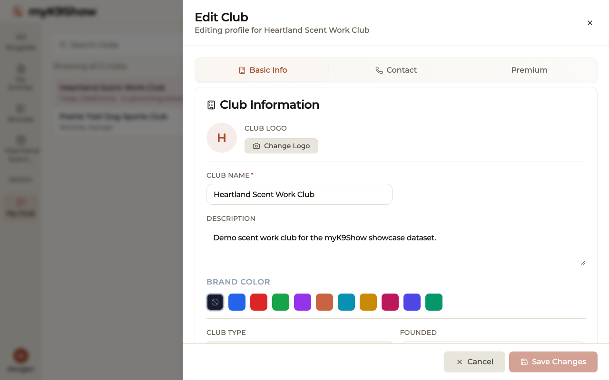
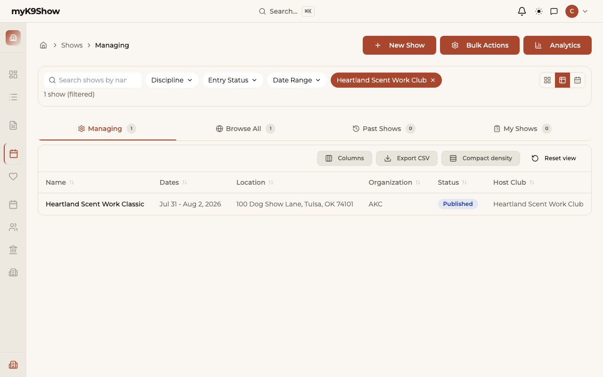
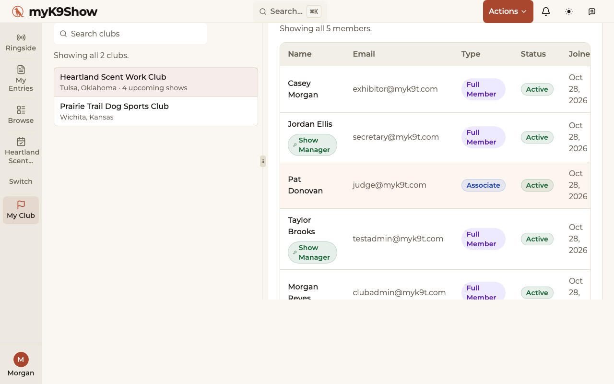
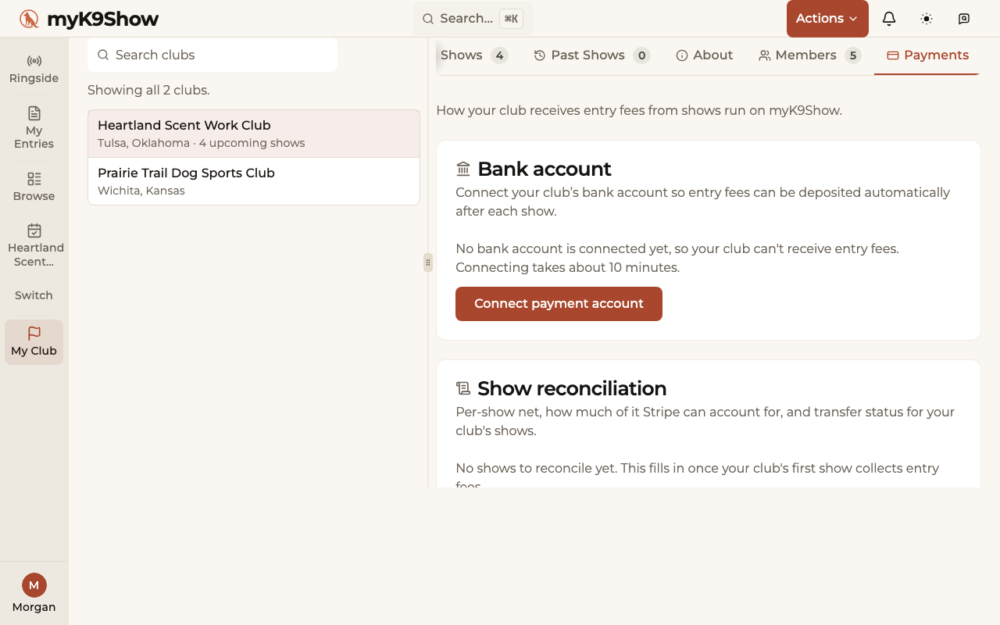
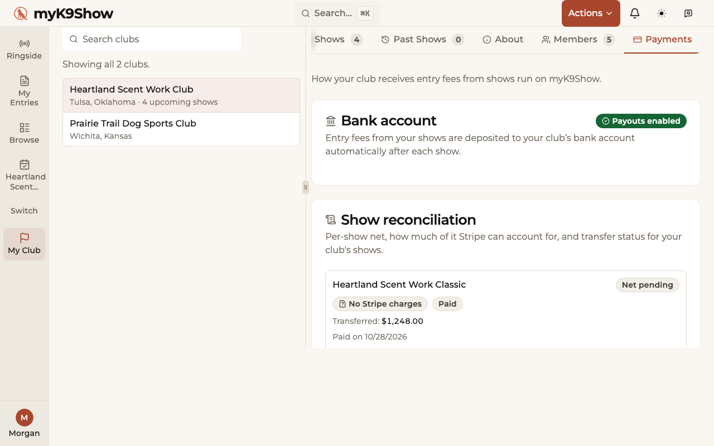
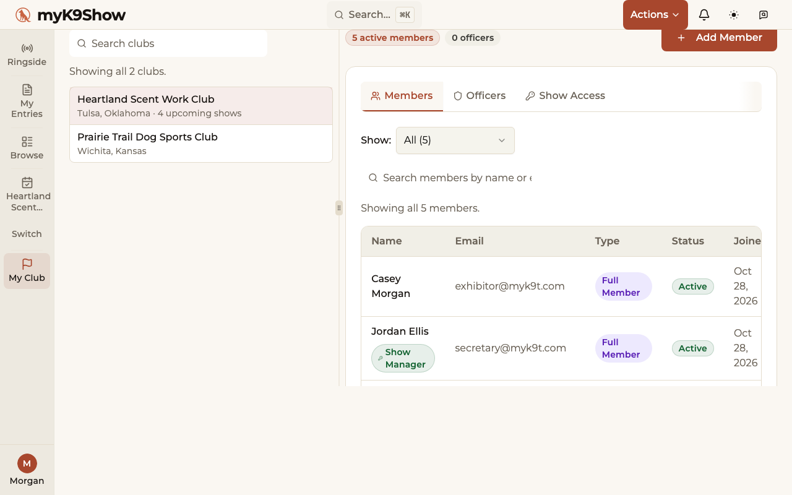
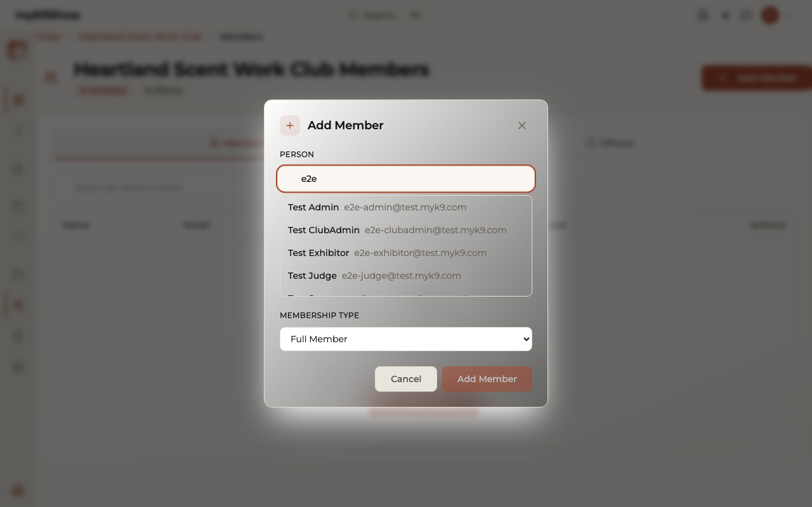

# Club Admin and Treasurer Guide

**Status:** `qa-draft`
**Audience:** Club administrators and treasurers
**Last verified:** 2026-10-28 — text checked against `main` at `0b537a807`; screenshots C-01, C-03, C-04, C-05 and C-06 recaptured 2026-10-28 against `main` at `542b6fa47`; non-author reviewer still pending
**Verified by:** text accuracy pass (documentation QA checklist, author walkthrough step list: labels, routes and flow steps checked against `apps/myk9show/src`); payout and fee claims last re-checked against `_shared/payoutCalc.ts` and `_shared/platformFee.ts` (MYK9-229), not re-checked in this pass; no browser walkthrough, screenshots re-captured 2026-10-28 from a throwaway local stack (no browser walkthrough of the text)

> **Note:** This is a QA-draft guide — written against the live app as a testing instrument. Ready screenshots are embedded; shots marked `blocked:` in the checklist below require specific seed data or conditions before they can be captured. Do not publish to customers until status is `verified`.

---

## What this guide covers

How to set up your club's profile, assign secretaries to shows, and connect your bank account to receive show payouts.

If you've used other show-management software before, the main change is that entries, payments, and results all flow through one place — you do not collect checks or log into a separate payment processor to see your balance.

---

## The platform and Stripe — who does what

Your club receives entry fees through a payment processor called Stripe. Here is the boundary between what myK9Show does and what Stripe does:

| myK9Show does                                                                              | Stripe does                                                             |
| ------------------------------------------------------------------------------------------ | ----------------------------------------------------------------------- |
| Hosts the show and collects entries                                                        | Processes exhibitor credit card payments                                |
| Calculates the amount owed to your club                                                    | Holds the money during the show period                                  |
| Initiates the deposit to your club after the show                                          | Deposits the money into your bank account                               |
| Shows payout history and status                                                            | Sends identity verification requests directly to the treasurer          |
| Charges exhibitors a service fee on top of the entry fee — never deducted from your payout | Deducts its card processing fee from the platform, not from your payout |

**Why Stripe contacts the treasurer directly:** Stripe is legally required to verify the identity of the account holder before releasing funds. This is a U.S. regulatory requirement, not a myK9Show request. When you receive an email from Stripe asking for information, respond directly to them.

### If you requested a new club

When a site admin approves your new-club request, myK9Show emails you and automatically gives you three club-scoped records for that club:

- an active **Club Admin** role;
- an active club membership, so you appear in the **Members** roster; and
- **Secretary/show manager** access, so you can create and operate that club's shows.

These permissions apply only to the approved club. You do not need to request secretary access again for that club, and this does not give you access to another club's shows.

---

## Section 1 — Club Profile Setup

Your club profile holds the information that flows into every show your club hosts and every AKC results submission: club name, AKC/UKC/ASCA club numbers, mailing address, and contact information. Keeping this current saves corrections later.

**Your club is already in the system** when you first sign in — a myK9Show admin created it from your club's request. You are here to review and update it, not create it from scratch. If your club is not in myK9Show yet, contact us.

1. Sign in with your Club Admin account.
2. In the sidebar, open **My Club**. Your club's page opens.
3. Open the **Actions** menu at the top → **Edit club**. The panel has three tabs: **Basic Info**, **Contact** and **Premium**.
4. Review each field:
   - **Club Name** (as it appears on AKC paperwork), **Description**, **Club Type** and **Founded** on **Basic Info**
   - **Email Address**, **Phone Number**, **Website**, **Street Address**, **City**, **State/Province**, **ZIP Code** and **Country** on **Contact**
5. Update any field that is out of date → click **Save Changes**.
6. For the club numbers, use **Edit** on the **Club numbers** line near the top of the page. Enter the **AKC club number**, **UKC club number** and **ASCA club number** that apply, and click **Save**.

Changes take effect immediately on all future shows. Existing shows that have already been submitted to AKC are not retroactively changed.

---

## Section 2 — Your Club's Shows

The **Shows** page lists every show your club is hosting or has hosted. To start a new show for your club, open your club's page and use **Actions** → **Add Show for this club**.

1. In the sidebar, open **My Club**, then **Our Shows**. (**Browse** opens every show you can see, with tabs for Shows and Dogs.) Your club's page also lists them under **Upcoming Shows** and **Past Shows**.
2. Each show card displays the show name, dates, and entry status.
3. Click a show to open it.

**You manage your club's shows.** Opening one of your club's shows gives you the same four tabs a secretary gets, and each tab is a real page with its own address, not a panel:

| Tab             | What you can do there                                                                                                                                                                 |
| --------------- | ------------------------------------------------------------------------------------------------------------------------------------------------------------------------------------- |
| **Overview**    | The show home: the schedule, each class's work and checklist, trials and classes (add, edit, delete); Add Trial, Select classes and the show tools are in the header **Actions** menu |
| **Entry Forms** | Approve entries, record payments, handle pulls, refunds, move-ups and the waitlist                                                                                                    |
| **Results**     | Review and release results, submit them to the registry, then close the show                                                                                                          |
| **Reports**     | Print any of the show's reports, grouped by **Before the show**, **During the show**, **After the show**, and **Anytime**                                                             |

The **Actions** menu in the top bar has **Edit show**, which opens the show's edit panel. It appears only for shows you manage; it does not expand your permissions.

**Three jobs stay with the trial secretary:**

- **Typing in entries on someone's behalf.** **Add entry** (Actions menu) and **Add late entry** (Entry Forms → More) are shown to you greyed out, with the reason **"Trial secretary access only"** — visible, so you can see they exist, but not yours to use.
- **Entering scores from paper.** **Enter results from scoresheet**, on the Overview class panel, is greyed out for the same reason. Scoring belongs to the judge and the secretary; you can read every score on the Results tab.
- **Volunteer scheduling.** **Open volunteer scheduling** in the show's Actions menu (Show logistics → Volunteers) is greyed out for the same reason; the scheduling page itself is the secretary's.

If you follow a link into one of those pages anyway, you land on a page that says **"Trial secretary access only"** and explains why, with a way back — not a dead end.

If your club needs any of those done, ask your secretary — or grant secretary access to the person who will do them (see [Section 3](#section-3--grant-show-access-to-a-secretary)).

---

## Section 3 — Grant Show Access to a Secretary

Show access is managed from the **Members** tab of your club's page, on its **Show Access** tab and in each member's action menu, not from the show itself. This is how you give **someone else** the operational role — you do not grant it to yourself. Your own club admin role already covers your club's shows (see [Section 2](#section-2--your-clubs-shows)).

When you appoint someone to show access, they can manage any of your club's shows, and they get the two things your own role does not carry: entering on an exhibitor's behalf (mail-in, phone, walk-up) and late entries, and volunteer scheduling. Everything else — entries, run order, show-day operations, results, and registry submission — they share with you.

**The person does not need to be a club member.** Appointment is the grant, and club membership is not checked, so you can appoint a hired or professional secretary who is not on your roster. A member whose membership lapses, is suspended, or is resigned keeps show access until you revoke it.

**To appoint anyone with a myK9Show account:** open **My Club** → **Members**, go to the **Show Access** tab, click **Appoint Secretary**, search for the person by name or email, select them, and click **Appoint**.

**To appoint someone already on your member list:**

1. In the sidebar, open **My Club**, then **Members**.
2. Find the person you want to make secretary.
3. Click **⋮** (the action menu) next to their name.
4. Under **Show Access**, click **Grant Show Access**.

The member's row now shows a **Show Manager** badge (key icon) indicating active show access. They can sign in and immediately access show management for all of your club's shows.

**When someone asks for access:** an exhibitor can ask your club for secretary access from **Request additional access**. Every active club admin of your club receives an email with their name, email address, and reason. The request also appears on the **Show Access** tab under **Pending requests**, which shows a count badge while requests are waiting. Click **Approve** to appoint them, or **Deny** to decline, optionally with a reason. The requester is emailed either way, and your reason is included in the email. They also see the decision, and your reason, when they return to **Request additional access**.

**To revoke access:** open the same **⋮** menu and click **Revoke Show Access**, or use **Revoke** on the **Show Access** tab. The person loses management access immediately. If they are a club member, they stay one.

> **Note:** Show access is club-wide — anyone you appoint can manage all of your club's shows, not just one. There is no show-by-show secretary access: naming someone as an official on one show is paperwork only and grants nothing. Judges are assigned to shows or classes separately and do not need to be club members.

---

## Section 4 — Connect Your Bank Account to Receive Payouts

Before your club can receive entry fee revenue, a treasurer needs to complete Stripe's onboarding. This takes about 10 minutes and only needs to be done once per club.

**Have this ready before you start:**

- Your club's EIN (it's on the club's tax paperwork)
- The club's legal name and mailing address
- One of the club's checks — use the club's bank account, not a personal one
- The treasurer's name, date of birth, home address, and the last 4 digits of their Social Security number

> **Why the SSN?** Stripe is required by law to verify the identity of the account representative. They ask for the last 4 digits only — not the full number.

**Steps:**

1. In the sidebar, open **My Club**, then **Payments**. Your club's page opens on its **Payments** tab, in a card called **Bank account**.
2. Click **Connect payment account**.
3. Review the checklist on screen — confirm you have everything listed above.
4. Click **Continue to Stripe** → you leave myK9Show and enter Stripe's onboarding form.
5. Fill in your club's details as prompted. When you finish, Stripe returns you to myK9Show.

Once onboarding is complete, the Payments tab shows a **Payouts enabled** badge. Your club will receive a deposit automatically after each show closes — you do not need to request it.

**Onboarding incomplete?** If you close the browser mid-way, return to **Payments** and click **Finish setting up** to pick up where you left off. If the setup link expired, click **Continue to Stripe**.

**Account under review?** Stripe sometimes reviews new accounts before enabling payouts. The Payments tab will show **Under review by Stripe**, with an **Add missing information** button in case Stripe asked for more. This typically resolves within 1–2 business days. If it takes longer, contact Stripe directly — they handle verification, not myK9Show.

For the full step-by-step treasurer walkthrough with screenshots, see [Club Treasurer Guide — Receiving Show Payouts](../operations/stripe-treasurer-guide.md).

---

## Section 5 — Payout Timing and History

After your show's end date, myK9Show automatically initiates a deposit to your club's linked bank account. The Payments tab shows each show's payout.

**When does the deposit arrive?**

Three days after the show's end date, myK9Show sends the transfer. Your bank typically posts it the following business day. Weekends and bank holidays may add one day.

**What is the deposit amount?**

> Total online entries collected − any refunds issued by your secretary

**Your club receives 100% of entry fees.** The service fee is never deducted from your payout: exhibitors pay it on top of the entry fee at checkout, and it covers Stripe's card processing plus running the platform. See [How our fees work](https://myk9show.com/fees) for the split.

**Example:** 40 entries at $32 each = $1,280 collected. After a $32 refund for one withdrawn entry, your club receives $1,248.

**Viewing past payouts:**

1. In the sidebar, open **My Club**, then **Payments**.
2. The **Show reconciliation** card lists each show with its net amount, the transfer amount, the date, and a status.

| Status                  | Meaning                                                          |
| ----------------------- | ---------------------------------------------------------------- |
| **Paid**                | Deposit sent; should appear in your bank within one business day |
| **Sending**             | Transfer is in progress                                          |
| **Scheduled**           | Your account is ready and the transfer has not gone out yet      |
| **Waiting for account** | Stripe onboarding is not yet complete                            |
| **Retrying**            | A transfer attempt failed; it will be retried automatically      |
| **Needs attention**     | A transfer failed and will not retry on its own                  |
| **Earlier attempt**     | An older transfer for the same show; a later attempt replaced it |

A show whose net amount is still being worked out reads **Net pending**.

**Need itemized records?** Open the show, go to the **Entry Forms** tab, and export from there — you do not need to ask the secretary. The **Reports** tab also carries the Financial Report, which sits under the **Anytime** heading because it is as useful while entries are open as it is at reconciliation.

---

## Section 6 — Common Treasurer Questions

**"Stripe is asking for my SSN — is this normal?"**
Yes. Stripe requires identity verification for all account representatives before enabling payouts. They ask for the last 4 digits of your SSN, not the full number. This is a legal requirement, not a myK9Show policy.

**"When will we get paid?"**
Three days after your show's end date. Your bank typically posts it the following business day. See [Section 5](#section-5--payout-timing-and-history).

**"Stripe says our account is under review. What do we do?"**
Wait 1–2 business days. Stripe reviews new accounts before enabling payouts. If it takes longer, contact Stripe directly at the email address they provided during onboarding.

**"How do we update our bank account in Stripe?"**
Log in to your Stripe Express dashboard at **express.stripe.com** using the email address you used during onboarding. From there you can update bank details, view transfer history, and manage the account.

**"What if we need to refund an entry after the show?"**
Your secretary handles refunds from the show's **Entry Forms** tab. If a refund is issued after the payout has already been sent, Stripe will deduct it from the next payout. Contact us if a refund exceeds the next payout amount.

**"What does the service fee cover?"**
Two things: Stripe's card processing, which myK9Show neither sets nor receives, and myK9Show's own share, which funds the platform your show runs on. It is charged to the exhibitor on top of the entry fee and is never taken out of your payout. The current rate and an approximate split are on the Payments tab and at [How our fees work](https://myk9show.com/fees).

---

## Section 7 — Club Members

The **Members** tab lists your club's member roster. Each member has a **Type** (Full Member, Associate, Junior or Honorary) and a **Status** (Active, Lapsed, Suspended or Resigned). Use it to add members, change their type or status, and give or take away show access.

> **Note:** This is not a general membership roster. It lists only people who have been added to your club in myK9Show. Membership alone does not let anyone set up or run shows; that is **Show Access** (Section 3).

**View current members:**

1. In the sidebar, open **My Club**, then **Members**. Your club's page opens on its **Members** tab.
2. The **Members** view lists each person with their type and status. Switch between **All**, **Active**, **Lapsed**, **Suspended** and **Resigned**, or search by name or email.

**Membership requests:** exhibitors can ask to join your club from **Request additional access**. Every active club admin of your club receives an email about each request. Waiting requests appear at the top of the **Members** view under **Membership requests**, and the tab shows a count badge. **Approve** adds the person to the member list as an active member, without show access. **Deny** declines, with an optional reason. The requester is emailed either way, and your reason is included. A denied person cannot send the same request again, but you can still add them yourself at any time.

**Add a member:**

1. On the Members tab, click **Add Member**.
2. Search for the person by name or email and select them.
3. Choose a **Membership Type**.
4. Click **Add Member** — they are on the roster immediately.

If the person does not appear in the search, they may not have a myK9Show account yet. Ask them to sign up first, then add them once their account is active.

**Change a member's type or status, or remove them:**

1. Find the member in the list → open their **⋮** action menu.
2. Choose **Change Type** or **Change Status** and pick the new value, or choose **Remove Member**.
3. For **Remove Member**, confirm with **Remove member**. They are off the roster immediately.

**Officers tab:**

The **Officers** tab tracks the club's formal officers. Click **Assign Officer**, choose the person and a **Position** (President, Vice President, Secretary, Treasurer or Board Member). This is for your club's internal reference. It does not change what anyone can do in the app.

---

## Still need help?

- [Club Treasurer Guide — Receiving Show Payouts](../operations/stripe-treasurer-guide.md) — full Stripe walkthrough
- [Secretary Guide](secretary-guide.md) — for the person managing show day
- Support: [placeholder — contact email or support page]

---

## Screenshot Checklist

All shots to be captured and added to `docs/training/screenshot-shot-list.md`. Status as of 2026-10-28 (stale = the app no longer looks like the caption; recapture before `verified`):

| Shot ID | Section | Description                                                    | Status       |
| ------- | ------- | -------------------------------------------------------------- | ------------ |
| C-01    | § 1     | Club Settings form — all fields visible                        | ready, stale |
| C-02    | § 2     | Club Admin → Shows list                                        | ready        |
| C-03    | § 3     | Members page — member row with Show Manager badge              | ready, stale |
| C-04    | § 4     | Payments page — pre-onboarding "Connect payment account" state | ready, stale |
| C-05    | § 5     | Payments page — payout history table                           | ready, stale |
| C-06    | § 7     | Club Members page — members list                               | ready, stale |
| C-07    | § 7     | Add Member dialog                                              | ready        |
