# Exhibitor Guide

**Status:** `qa-draft`
**Audience:** Dog sport exhibitors
**Last verified:** 2026-10-28 — text checked against `main` at `0b537a807`; screenshots E-04…E-07, E-09…E-12 and E-14…E-16 are out of date and need recapture; non-author reviewer still pending
**Verified by:** text accuracy pass (documentation QA checklist, author walkthrough step list: labels, routes and flow steps checked against `apps/myk9show/src`); no browser walkthrough, screenshots not re-captured

> **Note:** This is a QA-draft guide — written against the live app as a testing instrument. Ready screenshots are embedded; shots marked `blocked:` in the checklist below require specific seed data or conditions before they can be captured. Do not publish to customers until status is `verified`.

---

## What this guide covers

How to find shows, enter your dog, check your entry status, get to the ring on time, and see your results — all from one place.

If you're coming from paper entries or mySWT, the main change is that entries, payments, and results are all in one account. You don't need separate logins for each club.

---

## Section 1 — Find a Show

No account needed to browse. Go to myK9Show and open the shows list. If you are signed in, tap **Enter a Show** at the top of **My Shows** to get there.

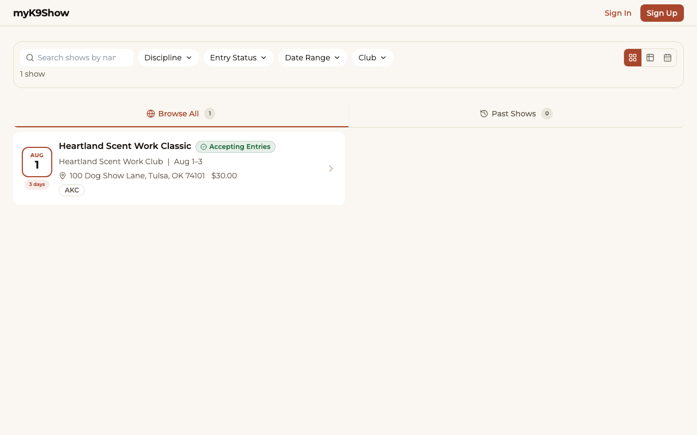

Each show card shows the name, sanctioning organization, dates, entry deadline, and status:

| Badge             | Meaning                                  |
| ----------------- | ---------------------------------------- |
| Accepting Entries | Entry window is open — you can enter now |
| Closing Soon      | Entry deadline is within 7 days          |
| Entries Closed    | Entry window has passed                  |

Click any show to open its detail page — trial schedule, classes offered, entry fee, and deadline.

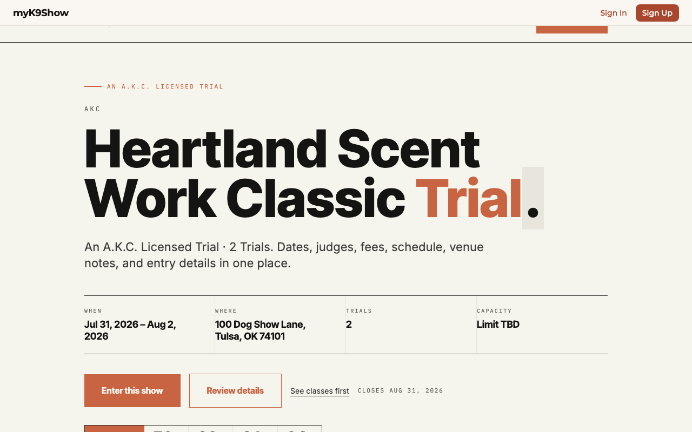

When you're ready to enter, click **Enter This Show**. If you already have entries in this show, the button reads **Add Entry** instead. If you don't have an account yet, you'll be prompted to create one (Section 2).

---

## Section 2 — Create an Account

If this is your first time, you'll need an account before entering a show.

1. From the show detail page, click **Enter This Show**.
2. On the sign-in screen, click **Sign up** (under "Don't have an account?").
3. Under **I am…**, tick **Exhibitor (I show dogs)**.
4. Enter your first name, last name, email address and a password (at least 6 characters).
5. Check your inbox for a confirmation email → click the link to verify your address. If it does not arrive, use **Resend email**.
6. You're signed in and ready to enter.

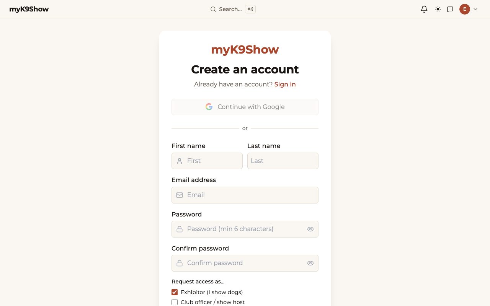

**Next step:** Add your dog before returning to enter the show — the entry wizard requires at least one dog in your profile (Section 3).

**Already have an account?** Click **Sign in** from any show detail page and skip to Section 3.

---

## Section 3 — Add Your Dog

Before entering a show, your dog needs a profile in your account.

1. Go to **My Dogs** in the navigation.
2. Click **Add Dog**. The panel opens on the **Registration** tab.
3. Choose the **Registration Organization**, type the **Registration Number**, and click **Find dog**. If the dog is already in myK9Show, you are offered that dog instead of a second copy. If the number belongs to a dog you cannot see, you are told it is already registered to another dog. Contact the show secretary.
4. Otherwise, fill in the **Registered Name** and **Registered Breed** (the other registration fields are optional), then click **Save and continue**.

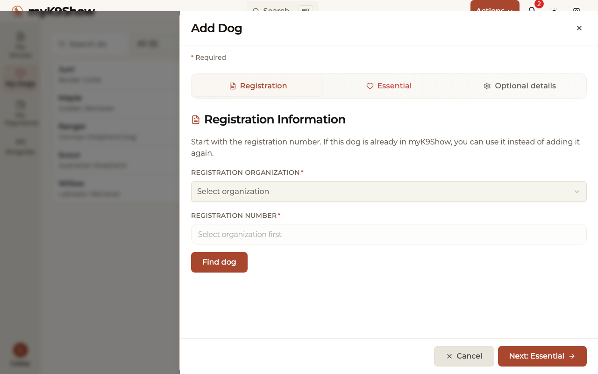

5. On the **Essential** tab, fill in:
   - **Call Name** (required) — the name used on the scoresheet
   - **Sex** (required)
   - **Date of Birth** (required)
6. Open the **Optional details** tab (color, height, weight, microchip). You can leave it blank. **Add Dog** appears on this last tab, so click it there.

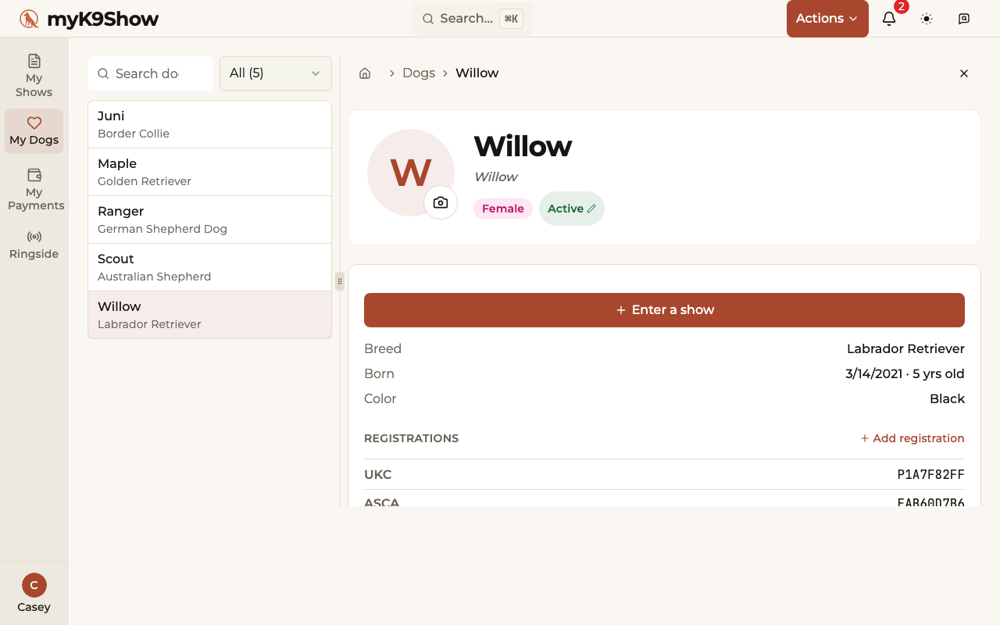

Your dog now appears in your list and is ready to enter shows. The confirmation also offers **Enter a show**.

**Tip:** Add the registration number now. If it's missing when the secretary submits results to AKC, they'll need to contact you before the file can be sent. Takes 10 seconds and saves a back-and-forth.

---

## Section 4 — Enter a Show

> **Before you start:** Make sure you've added your dog first (Section 3). You pick the dog on the first step, and the wizard has nothing to enter without one.

1. Open the show you want to enter → click **Enter This Show**.
2. The registration wizard opens. Its steps run **Dogs**, **Classes**, **Payment**, **Receipt**.

**Step 1 — Dogs:**

3. Under **Select Dogs to Enter**, pick the dog or dogs you are entering. Click **Next**.

**Step 2 — Classes:**

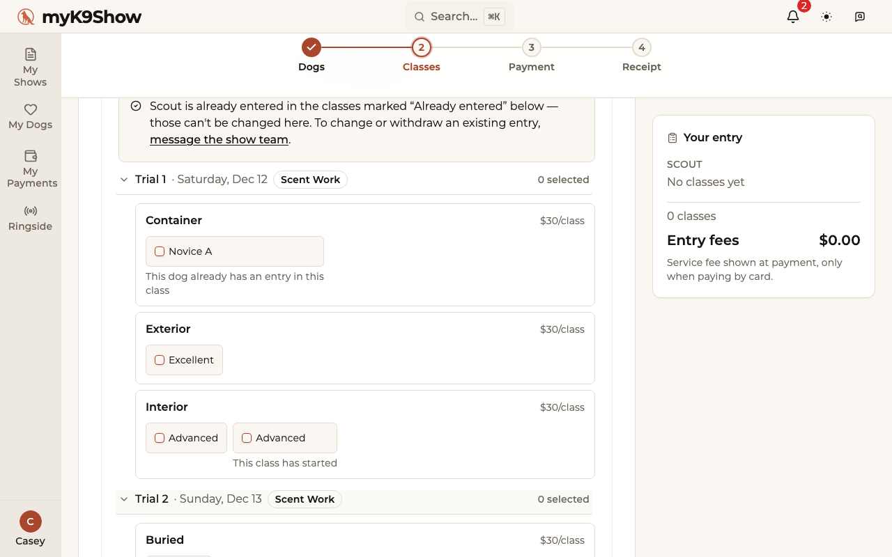

4. Classes are grouped by trial, then by element, with the level in each class name. Select the class or classes you want to enter. A toast reading **Added to your entry** confirms each selection.

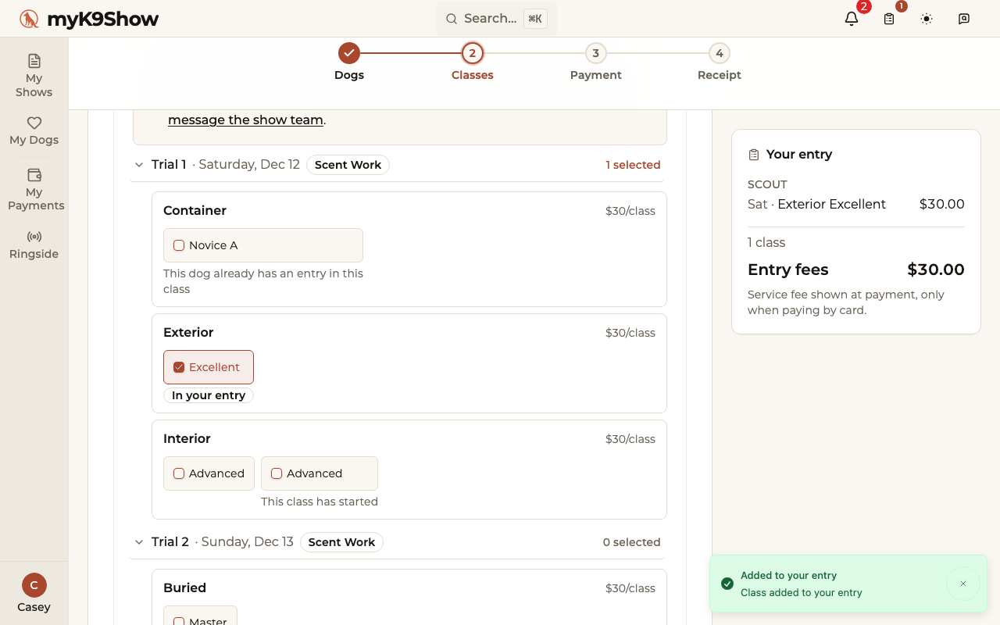

5. Click **Next**.

**Step 3 — Payment:**

6. Review the fees, then choose a payment method. **Credit/Debit Card (Online Payment)** is offered when the show takes online payment. **Check (pay at show)** and **Cash (pay at show)** appear only if the show accepts them.
7. Read and accept the entry agreement, then click the button at the bottom. It names what happens next: **Submit & pay** for card, **Submit — pay cash at show** or **Submit — bring check to show**.
8. For card, complete payment in the secure checkout screen. Your spots are held for 30 minutes while you pay, and if checkout times out first your cart is saved and checking out again re-checks the spots.

**Step 4 — Receipt:**

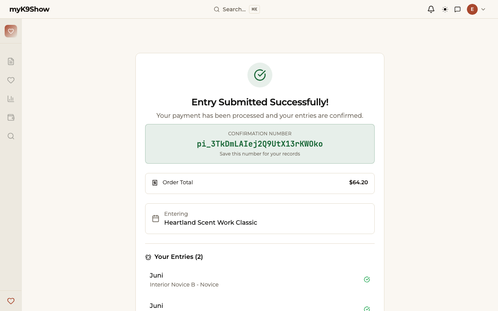

9. After payment, you're returned to myK9Show with **Entry Submitted Successfully!** and your confirmation number.
10. Your entry starts as **Pending review** — it moves to **Accepted** once the secretary reviews it.

**Entered the wrong class?** Leaving a class and entering another are separate steps. On **My Shows**, use **Leave class…** on the class row (Section 9), then **Actions → Add Entry** for the show to pick the right class. **Actions → Change handler or jump height** edits only those two things. If the entry deadline has passed, use **Message the show team** (also under **Actions**) to contact the secretary.

### Waitlists are free

If a class is full and the show allows a waitlist, you can join it at no cost. You're never charged just for joining a waitlist. If a spot opens, you'll get an email and a push notification, and you pay only if you decide to claim the spot, before the deadline shown in the message. If you don't claim it, nothing is charged and the offer moves to the next dog.

---

## Section 5 — Track Your Entry

Go to **My Shows** in the navigation to see all your entries. The page is one column: a **Today** section for a show running today, then **Upcoming shows**, soonest first, each with your dogs and their classes inline. Finished shows sit in a collapsed **Past shows** section at the bottom. Open it to see them.

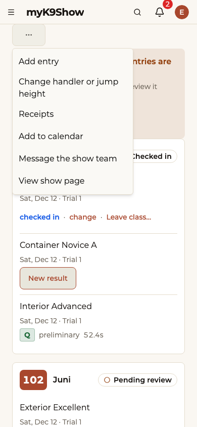

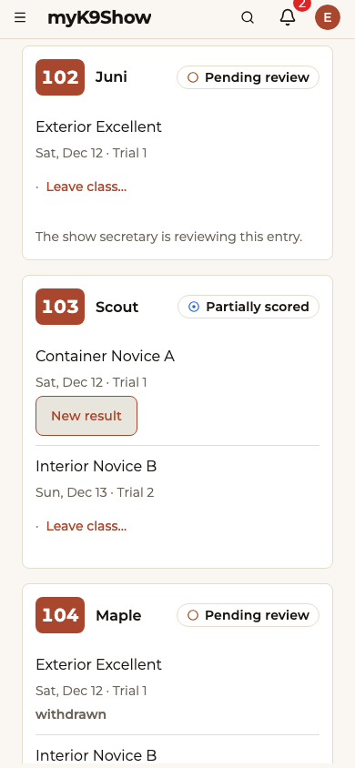
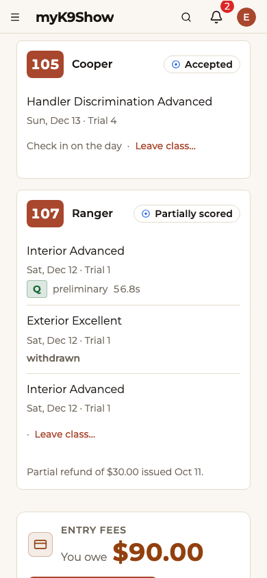

Each show has an **Actions** menu: **Add Entry**, **Change handler or jump height**, **Receipts**, **Add to calendar**, **Message the show team** and **View show page**. Items that do not apply to that show are left out.

**Status meanings:**

| Status                 | What it means                                       |
| ---------------------- | --------------------------------------------------- |
| **Pending review**     | Received — awaiting secretary review                |
| **Accepted**           | You're in                                           |
| **Waitlist**           | Class is full; you're in queue                      |
| **Information needed** | The secretary needs something from you              |
| **Declined**           | Your entry was not approved — contact the secretary |

**When the status changes to Accepted,** you'll receive a push notification (if notifications are enabled on your device).

**Unpaid entries:** If you see a **Finish Payment** button, your entry is reserved but payment didn't complete. Tap it to return to checkout before the deadline.

---

## Section 6 — See Your Place in the Run Order

You see your own dogs' place in line, not the whole run order. Open the show page (**Actions → View show page**) and choose the **My Entries** tab. **Where to be & when** lists each of your classes by day, with the start time, your armband number, and your place.

1. Go to **My Shows**.
2. Open the show's **Actions** menu → **View show page**.
3. Choose **My Entries**. Tap a class to open it.
4. The class page opens with a box, **Your dog in this class**, showing your place and your armband number.

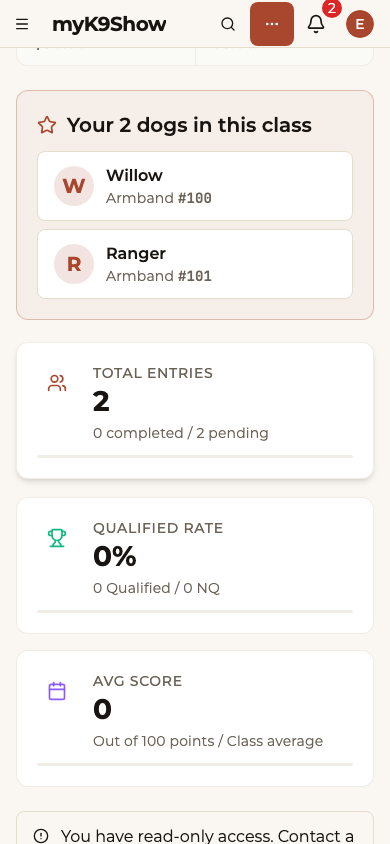

**Armband numbers** are assigned by the secretary and may not appear until close to show day.

Once the secretary has set the order and the trial day has arrived, your dog shows its place in line: **Next up**, **2nd up**, **3rd up** and so on, with how many dogs are ahead of you. The dog in the ring is not counted, so **Next up** means you go after the dog running now. When it is running or has finished, it shows **In ring** or **Done**. Without an internet connection the app cannot count the line, so your dog shows **Waiting** until you are back online; watch the ring and the Message Center for your turn. The app does not estimate a wait time. Before the secretary sets an order, the row reads **Order not set yet**.

**Ring assignments** are communicated by the secretary directly — they're not tracked in the app.

**Don't see a place?** The run order hasn't been set yet, or the show is still days away. Watch for an announcement in the Message Center.

---

## Section 7 — Check In on Show Day

Check your dog in so the secretary and stewards know you're at the show.

**Show day banner:**

On show day, a green banner reading **Show day is here** appears near the top of My Shows. It only shows on the actual day of your show.

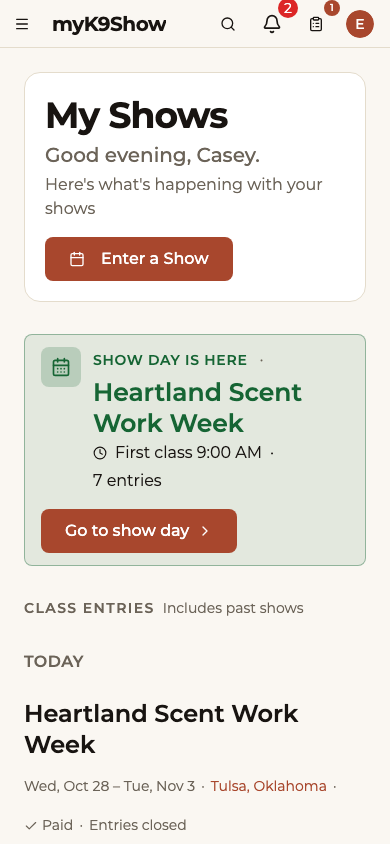

Tap **Go to show day** to open Ringside for that show. A **Where to be today** bar on the show also takes you there.

**Check in:**

On the day of the trial, a class that is open for check-in shows a **Check in** link on its row, and the dog's card shows a **Check in for** button with the day's name. Tap either, and the dog is checked in. If check-in is not open for a class, its row reads **check in with the secretary**. Before the day, it reads **Check in on the day**.

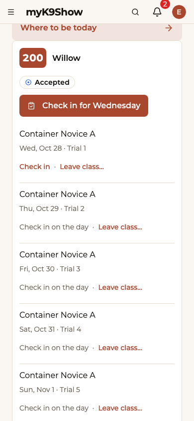

Once you check in, the class row reads **checked in** and the dog's card shows **Checked in**. Use **change** on the row to tell the secretary you are **at the gate**, have a **conflict**, or that the dog is **pulled** from that class. That last choice only tells the secretary. It does not withdraw the entry or change the fee.

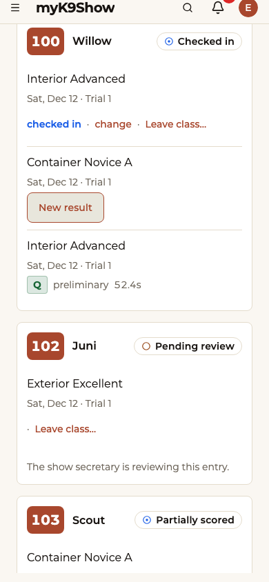

**No Check in link?** The secretary controls whether check-in is open, and your entry must be accepted. If you don't see it, check back closer to your ring time, or ask the secretary.

---

## Section 8 — View Your Results

After the class is scored and the secretary releases results, they appear on your class row.

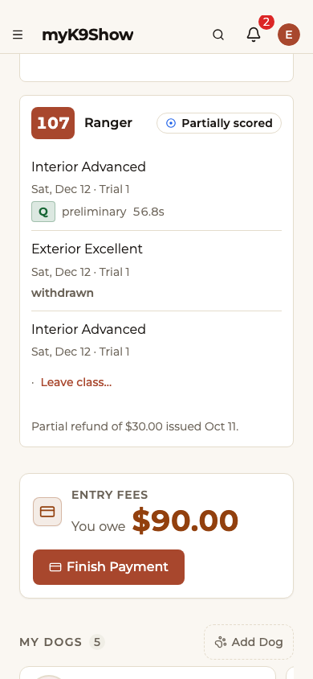

Each scored class shows:

- **Q** (qualified) or **NQ** (did not qualify)
- Your placement (1st, 2nd, 3rd, …)
- Your search time

A result you have not opened yet shows a **New result** button. Tap it to reveal the result. After that, a **Result card** button opens it again. To see the whole class, open the class from the show page's **Results** tab.

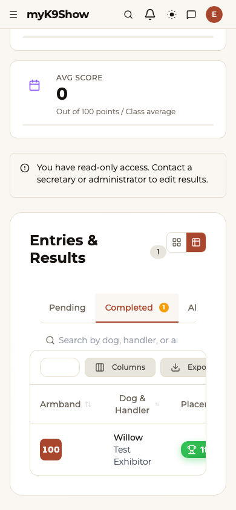

**Does a Q count toward my title?** A Q counts toward your AKC title if the class is at or above your current level and the secretary submits results to AKC. Title totals are tracked through AKC directly — myK9Show doesn't display cumulative title points.

---

## Section 9 — Leave a Class: Withdraw or Pull

Leaving a class is one of two different acts, and the app records which one you chose:

- **Withdraw** — only for a reason the show's rulebook recognises (for AKC and UKC: your dog is in season, or the judge changed). The show secretary confirms any refund under the premium's rules.
- **Pull** — any other reason: you have decided not to run. Refunds for a pull are at the club's discretion.

To leave a class:

1. On **My Shows**, find the class on your dog's card and tap **Leave class…**.
2. Choose **Withdraw** (and pick the reason) or **Pull**.
3. Confirm with **Withdraw entry** or **Pull entry**. **Keep my entry** closes without changing anything.

The class then reads **withdrawn** or **pulled** on your card. A dog pulled from the ring on the day by the show team reads **pulled at the show** instead.

Neither act moves money on its own. Refund terms are in the show's entry agreement.

Any refund returns the entry fee only. The service fee you paid at checkout is not refunded, including when the show is cancelled. Two exceptions are refunded in full:

- If a class you paid for was already full when your payment went through, that entry is refunded together with its share of the service fee.
- A payment that bought nothing at all, such as a checkout completed after the cart was abandoned, is refunded in full, service fee included.

---

## Section 10 — Payments and Receipts

Go to **My Payments** in the navigation. The **Amount due** section at the top shows what you still owe. Below it is every online entry payment you've made, newest first. Each row shows the date, show, description, amount, and status (Paid, Refunded, Failed, Cancelled, Pending or Processing).

To print a receipt, use the **Receipt** link on the row — it opens **My Shows**, where the printable receipt lives with each entry. You can also open **Receipts** from a show's **Actions** menu on **My Shows**.

---

## Section 11 — Manage Your Dog's Profile

1. Go to **My Dogs** in the navigation.
2. Click a dog's name → the detail page opens.
3. Open the **Actions** menu at the top → **Edit dog** → update any field → click **Save Changes**.

Fields you can update include call name, breed, sex, date of birth, color, height, weight, microchip number, and the AKC or UKC registration. The dog's registered name and registration number live in its registration, which is edited from the same panel.

**Competition history:** On the dog detail page, choose **Career**, then **Past Results**, to see past entries and results for that dog.

---

## Section 12 — Set Up a New Club

If your club is not already in myK9Show, you can ask the myK9Show team to set it up without creating a second account.

1. Open the account menu, choose **Account**, then click **Request additional access**.
2. Under **Set up a new club**, click **Request a new club**.
3. Enter the **Club name** (the club's website and a message are optional) and click **Send request**.
4. Wait for a site admin to review the request.

Within a few minutes of sending, myK9Show emails you a confirmation at the email address on your account, and the myK9Show site admins are emailed that a new request is waiting. When a site admin approves or denies the request, you get a second email. If it is denied, that email includes the reviewer's note when one was entered.

When the request is approved, the person who submitted it becomes an active member, **Club Admin**, and the club's **Secretary/show manager** for that club. Those permissions apply only to the new club. They can then create and run that club's shows using the same account.

---

## Section 13 — Join an Existing Club or Ask for Secretary Access

If your club already uses myK9Show, you can ask it for either of two things. They are separate requests, and the club's admins decide each one.

1. Open the account menu, choose **Account**, then click **Request additional access**.
2. Under **Join an existing club**, click **Find an existing club**, search for the club, and select it.
3. Choose what you are asking for:
   - **Ask to join as a member** — puts you on the club's member list. Membership does **not** let you set up or run shows. A message to the club is optional.
   - **Ask for secretary access** — asks the club to let you set up and run its shows. Tell the club why you are asking; this is required.
4. Click **Send request**. The page shows **Request sent**, and from then on shows **Your request is under review** instead of another send button.

Nothing changes on your account until the club approves. Within a few minutes, myK9Show emails you a confirmation, and each of the club's admins receives an email with your name, email address, and reason. They review the request on the **Members** tab of the club's page. When they approve or deny it, myK9Show emails you, including their note if they wrote one. Coming back to this page later also shows the current status: under review, approved, or not approved, with the club's note if they wrote one.

If the club denies a request, you cannot send the same request again from this page. Contact the club directly if you think it should be reconsidered.

---

## Still need help?

- [KB: enter-a-show](#) — step-by-step for the registration wizard
- [KB: entry-status](#) — what each status badge means
- [KB: find-run-order](#) — how to see your class schedule
- [KB: check-in](#) — show-day check-in walkthrough
- [KB: view-results](#) — where results appear and when

---

## Screenshot Checklist

All shots from `docs/training/screenshot-shot-list.md`. Status as of 2026-10-28 (stale = the app no longer looks like the caption; recapture before `verified`):

| Shot ID | Section | Description                                                   | Status                     |
| ------- | ------- | ------------------------------------------------------------- | -------------------------- |
| E-01    | § 1     | Shows list with entry status badges                           | captured 2026-06-19        |
| E-02    | § 1     | Show detail — "Enter This Show" CTA                           | captured 2026-06-19        |
| E-03    | § 2     | Sign-up form                                                  | captured 2026-06-19        |
| E-04    | § 3     | My Dogs list                                                  | captured 2026-06-19, stale |
| E-05    | § 3     | Add Dog form                                                  | captured 2026-06-19, stale |
| E-06    | § 4     | Registration wizard — Step 1 (class selection)                | captured 2026-06-19, stale |
| E-07    | § 4     | Registration wizard — Step 1 with class selected + cart toast | captured 2026-06-19, stale |
| E-08    | § 4     | Confirmation receipt                                          | captured 2026-06-20        |
| E-09    | § 5     | My Shows — Pending entry card                                 | captured 2026-06-19, stale |
| E-10    | § 5     | My Shows — Accepted entry card                                | captured 2026-06-19, stale |
| E-11    | § 5     | My Shows — show card                                          | captured 2026-06-19, stale |
| E-12    | § 6     | Class detail — run order with armband number                  | captured 2026-06-19, stale |
| E-13    | § 7     | Show Today banner                                             | captured 2026-06-20        |
| E-14    | § 7     | Entry card — "Not Checked In" status pill                     | captured 2026-06-19, stale |
| E-15    | § 7     | Entry card — Checked In state                                 | captured 2026-06-19, stale |
| E-16    | § 8     | Entry card — Q result badge                                   | captured 2026-06-19, stale |
| E-17    | § 8     | Class results page                                            | captured 2026-06-19        |
