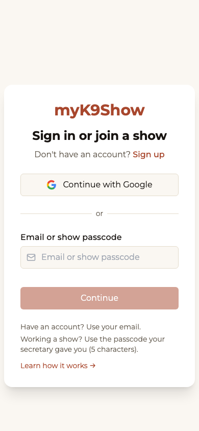
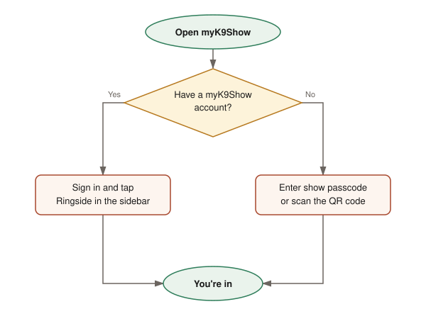
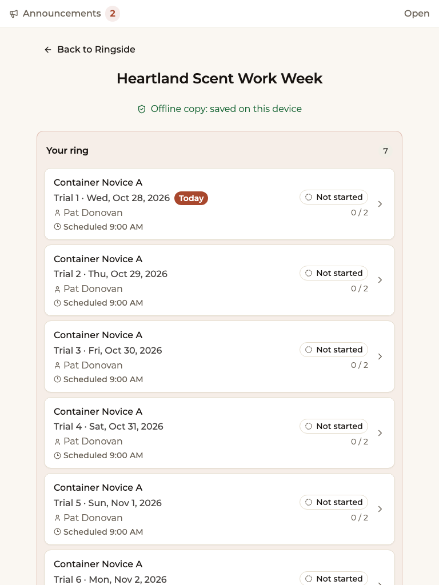
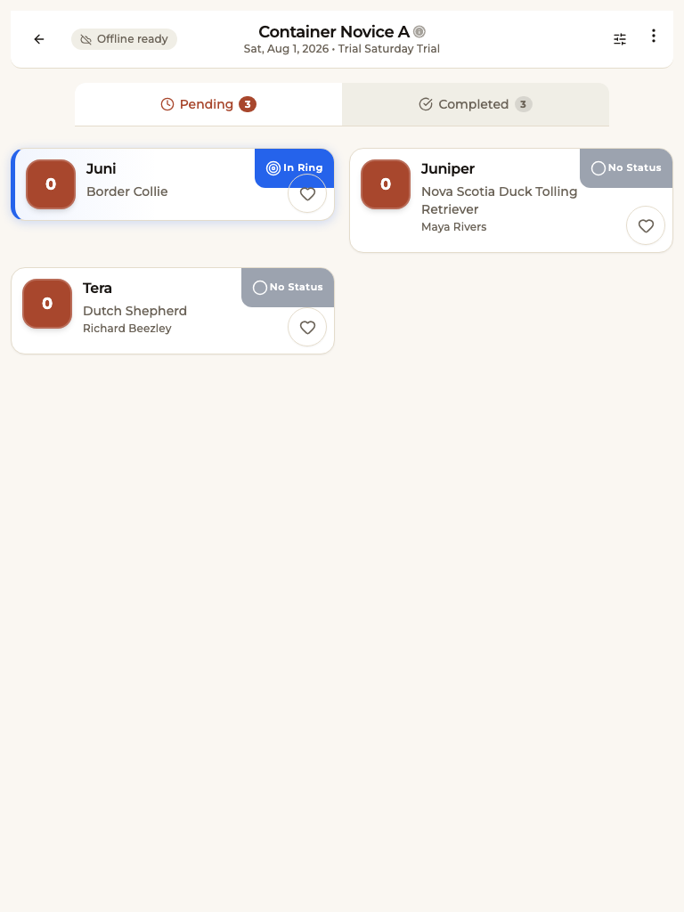
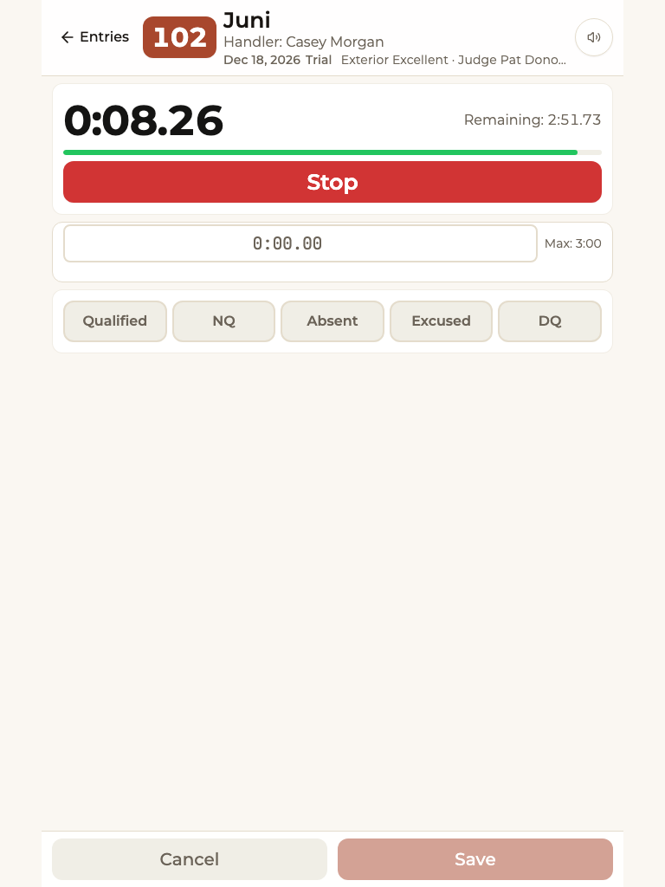
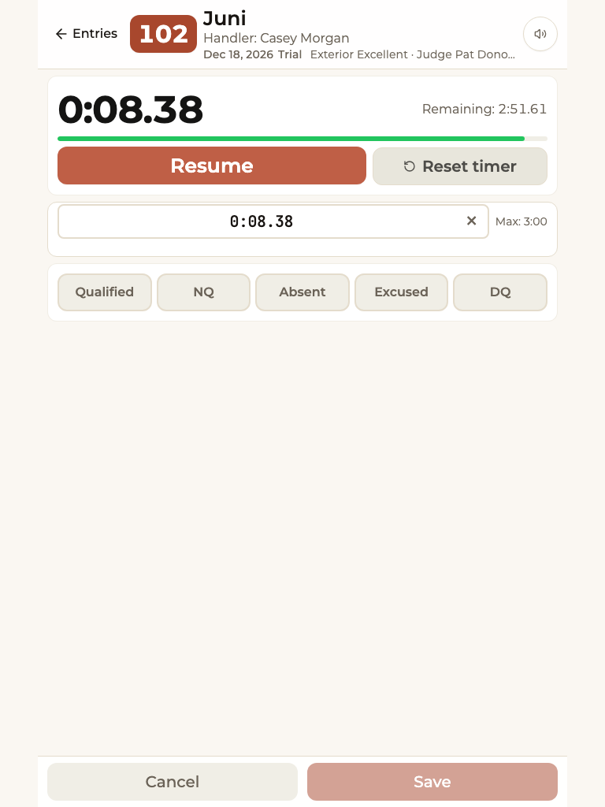
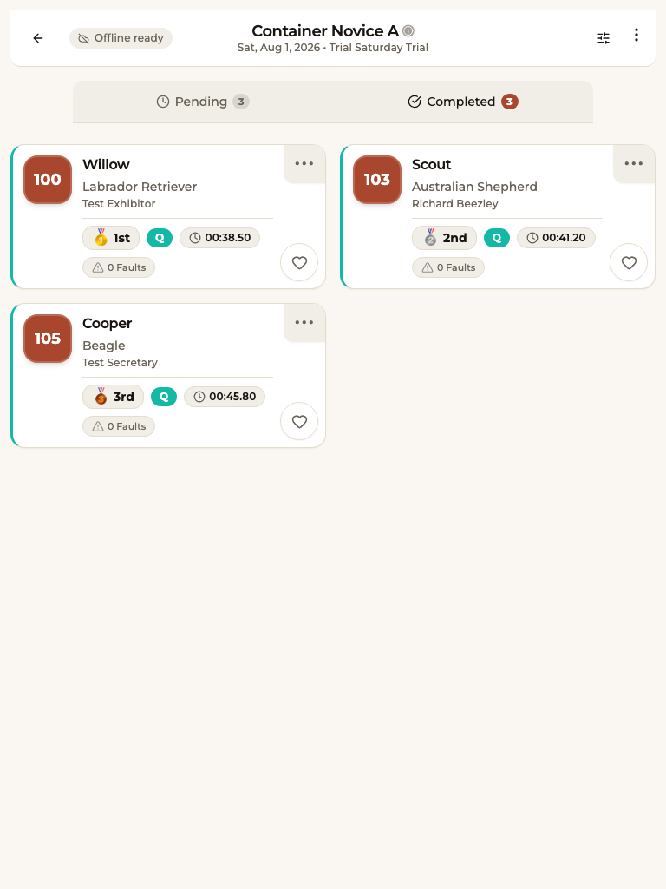

# Judge and Steward Ringside Quickstart

**Status:** `qa-draft`
**Audience:** Judges and ring stewards
**Last verified:** 2026-10-28 — text checked against `main` at `0b537a807`; screenshot J-02 recaptured 2026-10-28 against `main` at `542b6fa47`, and J-04 and J-05 recaptured 2026-11-03 against `main` at `2bc5b842e` (MYK9-1677); non-author reviewer still pending
**Verified by:** text accuracy pass (documentation QA checklist, author walkthrough step list: labels, routes and flow steps checked against `apps/myk9show/src` and `packages/scoring-ui`); no browser walkthrough, screenshots re-captured 2026-10-28 from a throwaway local stack (no browser walkthrough of the text)

> **Note:** This is a QA-draft guide written as a testing instrument. Screenshots (J-01…J-06) and the access-paths diagram are captured; a non-author reviewer pass is still needed — see the checklist at the end. Do not publish to customers until status is `verified`.

> **For volunteers:** This page is meant to print on a single sheet. Steps only. Keep your eyes on the dog — the app stays out of your way.

---

## Get into ringside

There are three ways in. Use whichever fits you.

**If you signed in with a myK9Show account** (assigned judges, secretaries):

1. Tap **Ringside** in the sidebar.
2. If one show is running today, it opens. If there is more than one, pick the show.
3. You're in. No passcode needed.

**If the secretary gave you a show passcode or QR code** (guest judges, stewards, volunteers):

1. Open myK9Show in your browser.
2. Type the **show passcode** into **Email or show passcode** and tap **Continue**, or scan the **QR code**.
3. You're in. No account needed.

**Don't have a passcode?** Ask the trial secretary before the show starts. They find it under **Show Access Codes** on the show's **Overview**.

---

## Find your class

After you're in, you land on the class list for the show. A judge with assigned classes sees **Your ring**: just their own classes. Stewards and other staff see every class, grouped by trial. Tap a trial's heading to open or close it.

1. Each row shows the **class name**, the **judge**, the **scheduled time**, a status badge, and how many dogs are **scored out of the total** (for example, 3 / 12).
2. Tap a class to open it.

**Classes that run two sections together** (for example, Novice A and Novice B) open as **one combined list**, with **All**, **Section A** and **Section B** tabs.

---

## See the run order

Tapping a class opens its entry list — the dogs in run order, on the **Pending** tab. Scored dogs move to the **Completed** tab.

1. Each entry shows the **armband number**, the **dog's call name**, the **breed**, and the **handler**.
2. **Stewards:** this list is yours to read. Use it to call dogs to the line. If you tap an entry, the scoresheet shows **No Scoring Access**, because stewards view ringside but do not score. Tap **Entries** to go back.
3. **Judges and others allowed to score:** tap an entry to open its scoresheet.

---

## Score a dog

This section is for the judge, or anyone the secretary has given scoring access. Record the result as soon as the dog finishes. It saves on your device first, then sends to the secretary.

1. Tap the entry to open the scoresheet.
2. Tap **Start** when the dog begins.
3. Tap **Stop** when the dog finishes or time is called.
4. Choose the result: **Qualified**, **NQ**, **Absent**, **Excused** or **DQ**.
5. Tap **Save**.
6. Check the **Score Confirmation** screen, then tap **Confirm & Submit**. **Cancel** takes you back to fix it.

After you confirm, a panel shows the result is saved on this device, and shows **Score saved** once it has reached the secretary. From there:

- **Back to Entries** returns to the list.
- **Correct this score** reopens the sheet with what you entered, so you can fix it.
- Optional shortcut: the next dogs by run order are listed under **Or jump straight to whoever is at the gate**. Tap one to open that dog's scoresheet.

The entry list updates to show the saved result. The secretary sees it once it syncs. They don't re-enter anything.

> **The timer is not the score.** Stopping the timer does not save anything. The result is only recorded when you tap **Save** and then **Confirm & Submit**.

### Classes with more than one area

A class with two or three areas shows one time field per area under the timer, labelled with the area's name. Time each area on its own:

1. For each area, tap **Start**, then **Stop** when that area is finished.
2. Tap **Record Area 1 time** (then **Record Area 2 time**, and so on; the button names the area). Stopping the timer alone does not put the time on the sheet. You can also type a time into an area's field.
3. Before you tap **Save**, check that every area's field has a time.
4. Choose the result and tap **Save**. On the **Score Confirmation** screen, check each area time and the total before **Confirm & Submit**. An area showing "--" was not recorded: tap **Cancel** and fix it.

---

## When the signal drops

Show venues often have weak signal. The app is built for it.

- Scoring and viewing the run order **keep working offline**.
- The sync label at the top reads **Offline**, then **Saved on this device** while scores are waiting to be sent. This is normal at most venues.
- A chip at the top reads **Offline ready** once the show is saved on the device, and **Preparing offline copy…** until then.
- Your work is saved on the device and **is sent automatically** when signal returns. The label changes to **All sent**.
- On the class list, **Offline copy: saved on this device** means the show is stored on your device. **Saved on this device** after a score means it has not reached the secretary yet.

**Scores not showing for the secretary after signal returns?** Reload the page once you have a solid connection. If entries are still missing, find the trial secretary.

---

## If something goes wrong

| What you see                              | What to do                                                                            |
| ----------------------------------------- | ------------------------------------------------------------------------------------- |
| You can't find your class                 | Check with the secretary — the class may not be published yet                         |
| The passcode doesn't work                 | Ask the secretary for the current code; they can regenerate it                        |
| Your scores aren't reaching the secretary | Check the sync label — it reads **Saved on this device** until the connection returns |
| The timer reset itself                    | Start timing again, then tap **Save** — scores are saved by hand, not automatically   |
| The app stops responding                  | Close the browser tab and reopen it. If you came in by QR code, scan it again         |

---

## Still need help?

Find the trial secretary at the show desk. They control access codes, the run order, and results.

---

## Screenshot Checklist

Shots from `docs/training/screenshot-shot-list.md`. Captured 2026-06-25 against staging unless the Status cell gives a later date.

| Shot ID                          | Section           | Description                    | Viewport | Status                          |
| -------------------------------- | ----------------- | ------------------------------ | -------- | ------------------------------- |
| J-01                             | Get into ringside | Passcode entry screen          | Mobile   | captured 2026-06-25             |
| J-02                             | Find your class   | Class list by trial            | Tablet   | captured 2026-10-28 (MYK9-1462) |
| J-03                             | See the run order | Entry list in run order        | Tablet   | captured 2026-06-25             |
| J-04                             | Score a dog       | Scoresheet — timer running     | Tablet   | captured 2026-11-03 (MYK9-1677) |
| J-05                             | Score a dog       | Q / NQ / Absent buttons        | Tablet   | captured 2026-11-03 (MYK9-1677) |
| J-06                             | Score a dog       | Entry list with a saved result | Tablet   | captured 2026-06-25             |
| `at-show-access-paths` (diagram) | Get into ringside | The two ways into ringside     | —        | drawn 2026-06-25                |
