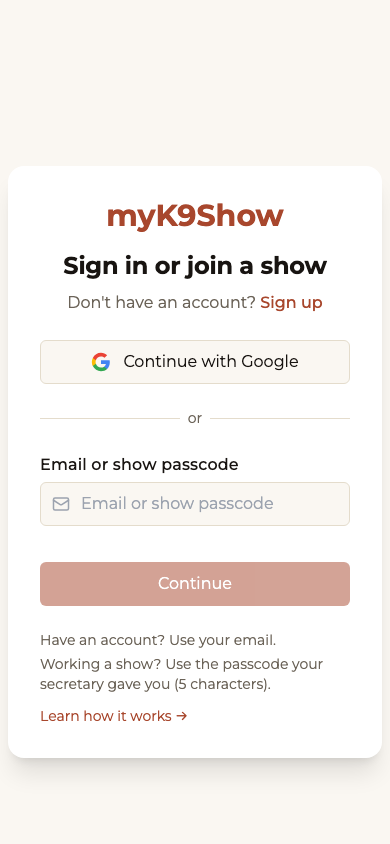
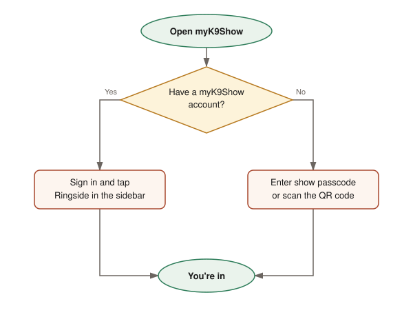
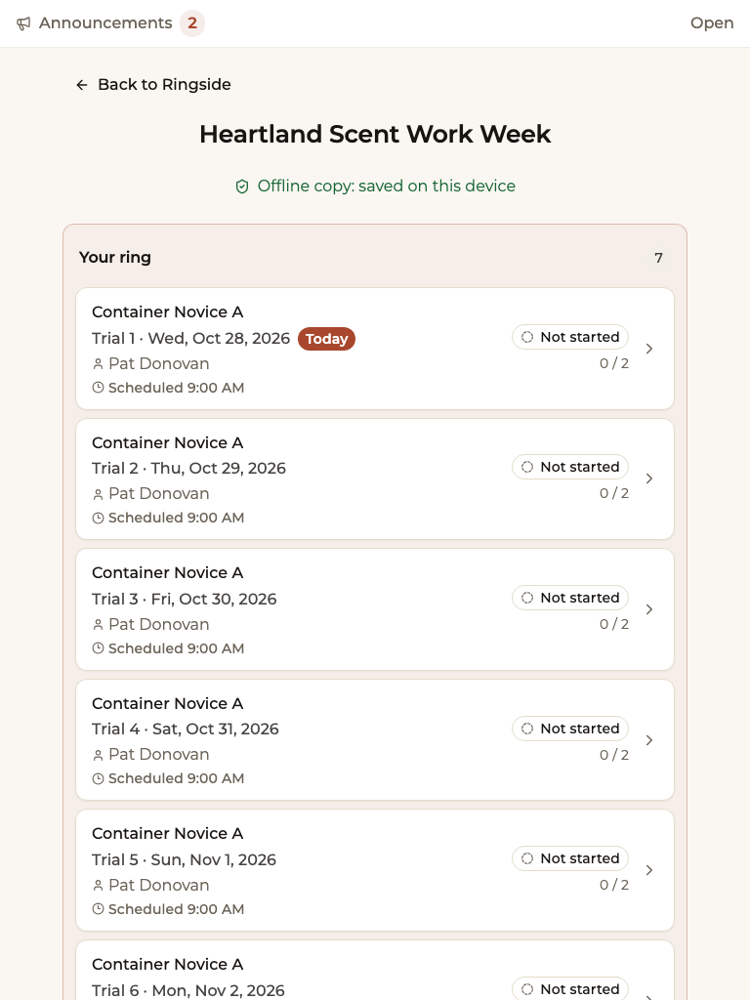
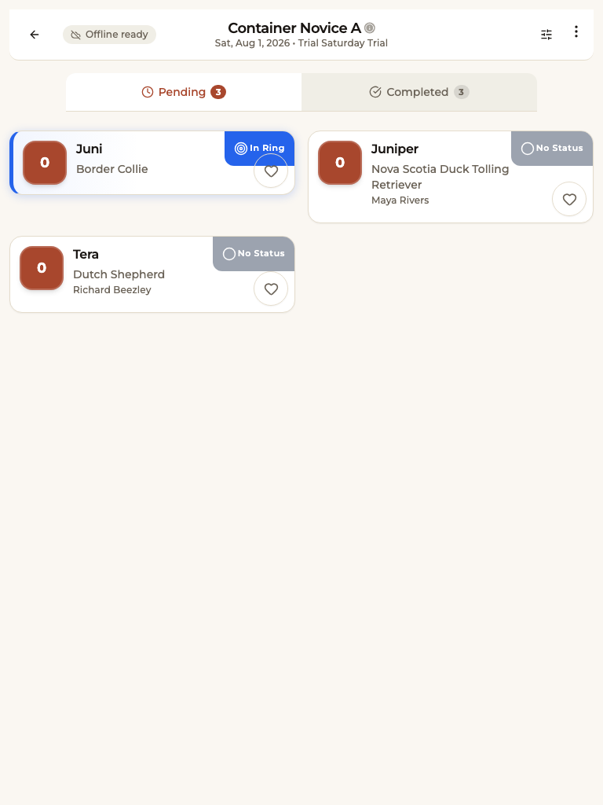
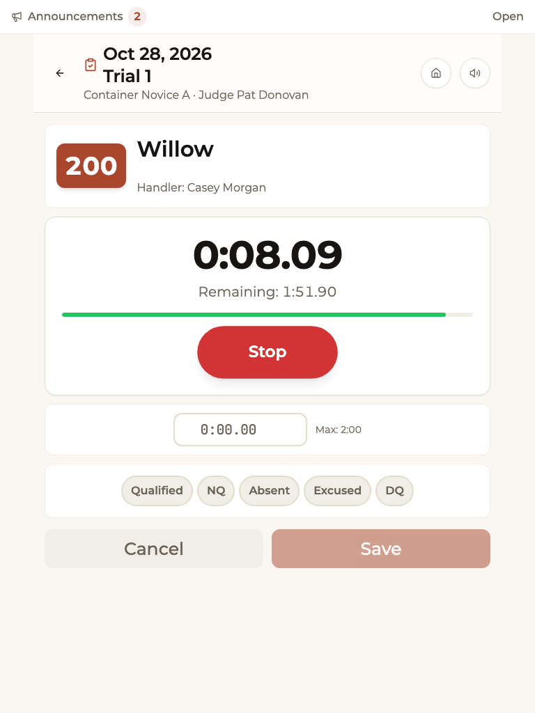
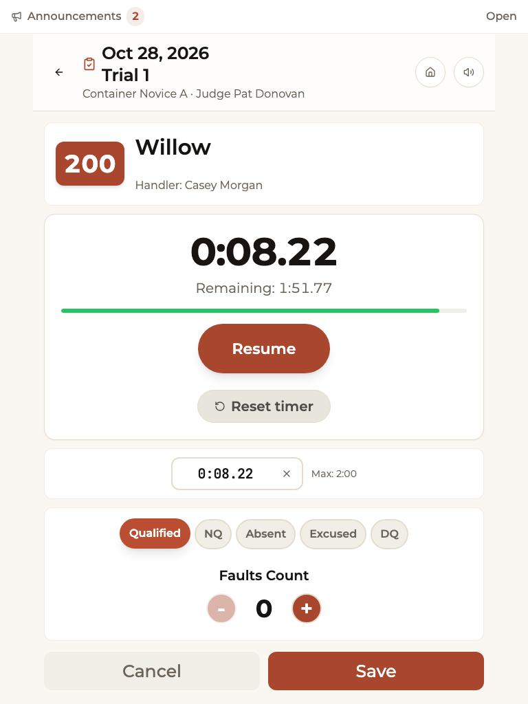
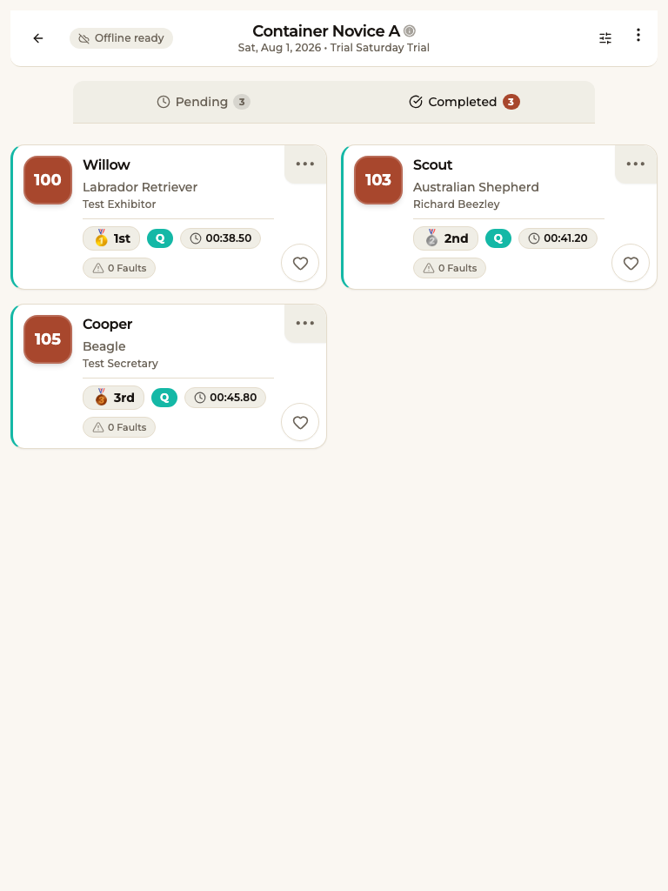

# Judge and Steward Ringside Quickstart

**Status:** `qa-draft`
**Audience:** Judges and ring stewards
**Last verified:** 2026-10-28 — text checked against `main` at `0b537a807`; screenshots J-02, J-04 and J-05 recaptured 2026-10-28 against `main` at `542b6fa47`; non-author reviewer still pending
**Verified by:** text accuracy pass (documentation QA checklist, author walkthrough step list: labels, routes and flow steps checked against `apps/myk9show/src` and `packages/scoring-ui`); no browser walkthrough, screenshots re-captured 2026-10-28 from a throwaway local stack (no browser walkthrough of the text)

> **Note:** This is a QA-draft guide written as a testing instrument. Screenshots (J-01…J-06) and the access-paths diagram are captured; a non-author reviewer pass is still needed — see the checklist at the end. Do not publish to customers until status is `verified`.

> **For volunteers:** This page is meant to print on a single sheet. Steps only. Keep your eyes on the dog — the app stays out of your way.

---

## Get into ringside

There are three ways in. Use whichever fits you.

**If you signed in with a myK9Show account** (assigned judges, secretaries):

1. Tap **Ringside** in the sidebar.
2. If one show is running today, it opens. If there is more than one, pick the show.
3. You're in. No passcode needed.

**If the secretary gave you a show passcode or QR code** (guest judges, stewards, volunteers):

1. Open myK9Show in your browser.
2. Type the **show passcode** into **Email or show passcode** and tap **Continue**, or scan the **QR code**.
3. You're in. No account needed.

**Don't have a passcode?** Ask the trial secretary before the show starts. They find it under **Show Access Codes** on the show's **Overview**.

---

## Find your class

After you're in, you land on the class list for the show. A judge with assigned classes sees **Your ring**: just their own classes. Stewards and other staff see every class, grouped by trial. Tap a trial's heading to open or close it.

1. Each row shows the **class name**, the **judge**, the **scheduled time**, a status badge, and how many dogs are **scored out of the total** (for example, 3 / 12).
2. Tap a class to open it.

**Classes that run two sections together** (for example, Novice A and Novice B) open as **one combined list**, with **All**, **Section A** and **Section B** tabs.

---

## See the run order

Tapping a class opens its entry list — the dogs in run order, on the **Pending** tab. Scored dogs move to the **Completed** tab.

1. Each entry shows the **armband number**, the **dog's call name**, the **breed**, and the **handler**.
2. Tap an entry to open its scoresheet.

---

## Score a dog

Record the result as soon as the dog finishes — it reaches the secretary instantly.

1. Tap the entry to open the scoresheet.
2. Tap **Start** when the dog begins.
3. Tap **Stop** when the dog finishes or time is called.
4. Choose the result: **Qualified**, **NQ**, **Absent**, **Excused** or **DQ**.
5. Tap **Save**.
6. Check the **Score Confirmation** screen, then tap **Confirm & Submit**. **Cancel** takes you back to fix it.

The entry list updates to show the saved result. The secretary sees it right away — they don't re-enter anything.

> **The timer is not the score.** Stopping the timer does not save anything. The result is only recorded when you tap **Save** and then **Confirm & Submit**.

---

## When the signal drops

Show venues often have weak signal. The app is built for it.

- Scoring and viewing the run order **keep working offline**.
- The sync label at the top reads **Offline**, then **Waiting to sync** while scores are queued. This is normal at most venues.
- A chip at the top reads **Offline ready** once the show is saved on the device, and **Preparing offline copy…** until then.
- Your work is saved on the device and **syncs automatically** when signal returns. The label changes to **Synced**.

**Scores not showing for the secretary after signal returns?** Reload the page once you have a solid connection. If entries are still missing, find the trial secretary.

---

## If something goes wrong

| What you see                              | What to do                                                                          |
| ----------------------------------------- | ----------------------------------------------------------------------------------- |
| You can't find your class                 | Check with the secretary — the class may not be published yet                       |
| The passcode doesn't work                 | Ask the secretary for the current code; they can regenerate it                      |
| Your scores aren't reaching the secretary | Check the sync label — it reads **Waiting to sync** until the connection returns    |
| The timer reset itself                    | Start timing again, then tap **Save** — scores are saved by hand, not automatically |
| The app stops responding                  | Close the browser tab and reopen it. If you came in by QR code, scan it again       |

---

## Still need help?

Find the trial secretary at the show desk. They control access codes, the run order, and results.

---

## Screenshot Checklist

Shots from `docs/training/screenshot-shot-list.md`. All captured 2026-06-25 against staging. Rechecked against the code 2026-10-28; "may be stale" means the caption no longer matches the current screen.

| Shot ID                          | Section           | Description                    | Viewport | Status                            |
| -------------------------------- | ----------------- | ------------------------------ | -------- | --------------------------------- |
| J-01                             | Get into ringside | Passcode entry screen          | Mobile   | captured 2026-06-25               |
| J-02                             | Find your class   | Class list by trial            | Tablet   | captured 2026-06-25, may be stale |
| J-03                             | See the run order | Entry list in run order        | Tablet   | captured 2026-06-25               |
| J-04                             | Score a dog       | Scoresheet — timer running     | Tablet   | captured 2026-06-25, may be stale |
| J-05                             | Score a dog       | Q / NQ / Absent buttons        | Tablet   | captured 2026-06-25, may be stale |
| J-06                             | Score a dog       | Entry list with a saved result | Tablet   | captured 2026-06-25               |
| `at-show-access-paths` (diagram) | Get into ringside | The two ways into ringside     | —        | drawn 2026-06-25                  |
