# Secretary Guide

**Status:** `active`
**Audience:** Trial secretaries
**Last verified:** 2026-11-04. The cards changed since 2026-10-21 were re-read label by label against the code on `main` (commit 084ea0e71), and the screenshots were retaken from the app built from it. The cards not touched were last checked label by label on 2026-10-03. Card 7 (the waitlist) was last walked in a real browser on 2026-10-12 (Nightly waitlist journey, run 38266836797): join from a full class, Offer Spot, the exhibitor's Claim by deadline and Decline, the automatic offer, a lapsed offer, and the one-time Mail-in dog needs an offer notice. Paying for an offer is not yet walked. The previous full browser walk was 2026-08-30.
**Verified by:** the secretary task walk (`docs/audits/2026-08-28-secretary-task-walk.md`), its 2026-08-29 verification pass, and the 2026-11-04 code check (MYK9-1605)

> **What "verified" covers here.** Paths, tabs and button labels were checked against the code, not
> walked end to end in a browser. Submitting results to a registry is the one flow never exercised
> end to end (that is a real submission).

> **About the screenshots.** They were retaken on 2026-11-04 from the show home as it is now
> (five tabs, header Actions menu). The demo show's data is thin, so a shot may show fewer
> entries than a real show has. Where a screenshot and the words disagree, the words are current.

> **How this guide is organised.** One card per job, in the order you'll do them. Each card tells you where to go, what to do, and what to watch for. If you only need one thing, jump to its card — they don't depend on each other.

---

## Before you start

**Sign in** at the show's URL and you land on **Home**. It lists the shows you manage with entry counts and anything needing attention. **Go to show** opens a show. **Pin** keeps one show as the show in the left rail; pin it again to let the rail pick for you.

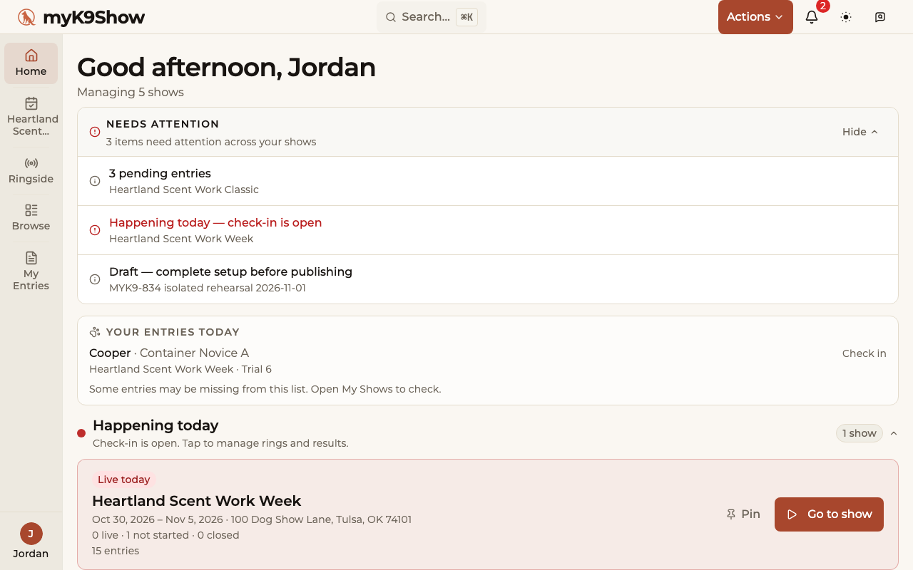

Open a show and you get **one row of five tabs**. Everything in this guide lives on one of them:

| Tab             | What it is                                                                                                                                                                                                          |
| --------------- | ------------------------------------------------------------------------------------------------------------------------------------------------------------------------------------------------------------------- |
| **Show Desk**   | Your show home: a **Needs attention** strip, the schedule by trial and day, and the selected class's panel with its status, timing, run order and actions. Called Overview before November 2026.                    |
| **Entry Forms** | One form per mail-in entry set or online checkout, with the dogs and classes they entered. Search and **Filter** find a form; the header **Actions** menu holds the lists (Pulls, Move-ups, Waitlist and the rest). |
| **Results**     | The show's classes with what each needs next: check the scores, release them, print, collect the judge's initials. **Submit to AKC** (or UKC, ASCA) and **Close the show** sit above the list.                      |
| **Reports**     | Printing: labels, check-in sheets, score sheets, catalogs and registry reports.                                                                                                                                     |
| **About**       | The show's facts, read only: where it is, entry fees, the withdrawal policy, officials and judges. The **Premium List** card that publishes the premium list is here. **Edit show** changes anything.               |

The **Actions** button in the top bar changes with the page you are on. On **Show Desk** it holds the show-day and show-logistics tools below. On **Entry Forms** it holds the entry lists instead (card 4).

| Show day                                                                               | Show logistics                                               |
| -------------------------------------------------------------------------------------- | ------------------------------------------------------------ |
| **Check-in desk**: look up exhibitors, armbands and check-in status, and check dogs in | **Volunteers**: helper assignments and gaps                  |
| **Self check-in**: turn exhibitor self check-in on by show, trial or class             | **Lunch orders**: plan lunch for everyone working each day   |
| **Access codes**: judge and ringside codes                                             | **Judge supplies**: what each judge is handed, once per show |
| **Emergency trial packet**: the printed paper fallback                                 | **Tasks and notes**: show-specific reminders                 |
|                                                                                        | **Incident log**: record incidents while fresh               |

> **A tool you do not use can be switched off.** In **Edit show → Venue & policies**, the **This show uses…** switches hide **Self check-in**, **Access codes**, **Emergency trial packet** and **Volunteers** from this menu. Nothing is deleted, and switching one back on brings the row back with its data. A new show starts with **Self check-in** and **Access codes** showing, and **Emergency trial packet** and **Volunteers** hidden until you switch them on. See card 3.

### Reading the schedule

Each class on **Show Desk** is one card: the start time, the class name with its status, the judge and entry count. **Click anywhere on a card** to open that class in the panel on the right. The "N pending" link on the card opens those entries for review.

Once you use the paperwork tracking (print a sheet from the app, or record a judge's initials), each card also shows a row of small squares, one per checklist item (green done, grey not done, amber needs reprint, outlined unknown), over "N of 7 steps done". Until then the cards stay quiet: no "Not done", no "0 of 7". See card 14.

> **Changed, October 2026.** Setup and Show Day are now part of **Show Desk**: one view before,
> during and after the show. Show closeout is the last step of **Results**, and adding entries
> (including late entries) is in the header **Actions** menu. Old bookmarks still work: they redirect to the
> matching place.

---

# Setting up

## 1 · Create a show, its trials, and its classes

The wizard creates all three in one pass. **Actions → Add Show** (the Actions button is in the top bar, on any page).

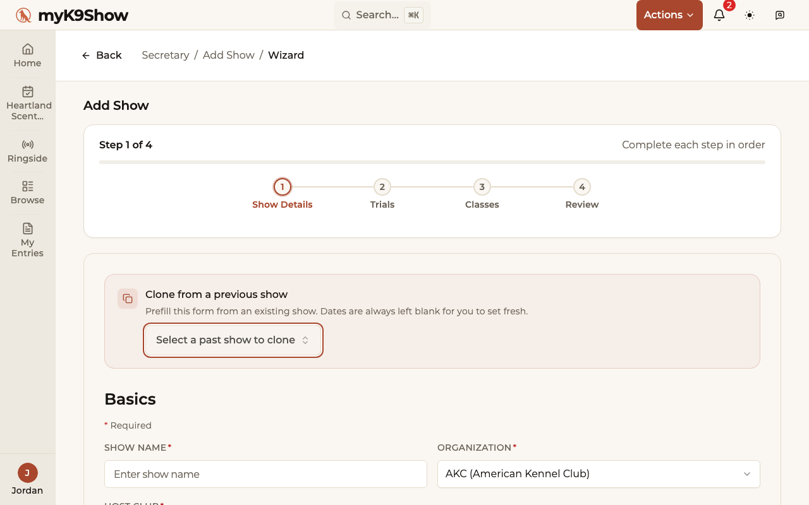

1. **Step 1 — Show Details.** Name, organization (AKC/UKC/ASCA), dates, location, host club, entry fee, and the entry open/close dates. Add your **chairman** and **secretary**.
2. **⚠️ Also on Step 1: add every judge** in the _Show Judges_ field. It looks optional. It is not — see the warning below.
3. **Step 2 — Trials.** One row per trial: date, time, and (for AKC) the event number.
4. **Step 3 — Classes.** Pick a template, then tick the classes each trial offers. Assign a judge per class.
5. **Step 4 — Review.** Check the summary, then **Add Show**. The show stays private until you publish it (card 2).

> **Adding your judges on Step 1 is still the smoothest path**, but no longer a trap: if you reach Step 3 without any, it now offers a way back to add them.

> **Entries closing on the show's first day is allowed** — normal for day-of entry.

## 2 · Publish the show

On the show page, open the **status pill** under the show's name and choose **Publish Show**. Exhibitors can find and enter the show once it is published.

> Publishing needs the club's Stripe payouts set up. If it is refused, the message says what is missing.

**The premium list.** Next to the status, a line in amber reads "premium list not yet published" until you publish one. Choose it and you land on **About**, on the **Premium List** card. **Generate & publish premium** builds the premium list from the show's details and publishes it. If your club shares its own premium list, switch on **We publish our own premium list** (card 3) and that reminder goes away. For a show that uses a public landing page, the same card then offers **Publish landing page**, and the line reads "landing page not yet published" until you do.

## 3 · Edit a show, or reassign a judge

- **Show details:** **Actions → Edit show** (the **Actions** button sits in the top bar, left of the bell), or **Edit show** on the **About** tab. The edit panel opens over the page you are on, with tabs **Basic Info**, **Officials**, **Judges**, **Fees**, **Venue & policies** and **Premium**.
- **Venue & policies:** each card or switch on this tab saves on its own, so the panel's **Save Changes** is not needed for it. The switches save the moment you flip them. The pin, WiFi and policy cards each have their own button (**Save pin**, **Save**, **Save policy**). It holds, in order:
  - **This show uses…** switches for the optional tools: **Exhibitor self check-in**, **Judges score on devices**, **Paper fallback packet**, **Volunteer tracking**, **Public landing page**, and **We publish our own premium list**. A club that never uses a tool can turn it off. A new show has self check-in and judges scoring on devices on, and the paper packet, volunteer tracking, public landing page and own premium list off, so switch on the packet or volunteers if you want those rows. The first four hide their row in the Show Desk **Actions** menu. **Public landing page** shows or hides the Landing page card and its reminder. **We publish our own premium list** stops the premium list reminder. Nothing is deleted when you turn a tool off. **Exhibitor self check-in** needs a connection to change. In the week before the show, **Ready for show day** (see Getting ready for show day) may offer one quiet suggestion for a tool that is off, such as "Want judges to score on their phones?", with a **Turn it on** link to this tab. The X beside it hides that suggestion on that device.
  - **Venue Map Pin**, **Venue WiFi** (network name and password, printed on the armband labels) and the **Withdrawal Refund Policy** for this show (**Save policy**). **About** shows the address, Wi-Fi and withdrawal policy read only.

  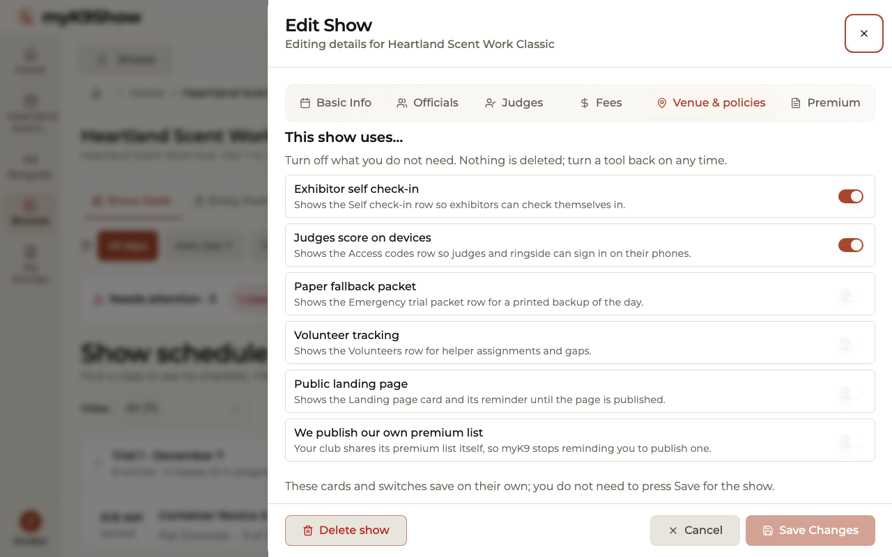

- **Add a judge to the show:** open **Edit show**, then the **Judges** tab.
- **Add classes to a show that already exists:** on **Show Desk**, open the **⋮** menu on the trial's heading and choose **Add classes**. The wizard opens on the **Classes** step with Show Details and Trials locked, because you are only adding classes. To add a trial instead, open the header **Actions** menu and choose **Add Trial**.
- **Edit or delete a trial or class:** on **Show Desk**, open the **⋮** menu on a trial's heading and choose **Edit Trial**. The same menu also has **Add classes**, **Trial report** (the registry's end-of-trial report, already set to that trial) and, on AKC shows, **High in Trial**. That trial's entries and money are on the **Entry Forms** and **Reports** tabs. **Delete trial** is the button at the bottom left of the edit panel. For a class, click it and use **Edit class** or **Delete class** in its panel. Deleting a trial or class also deletes its entries, so read the confirmation before you accept it.
- **Change a class's judge, or several classes at once:** **Actions → Select classes**, then the judge dropdown on that class's row. To set many classes in one trial to the same status, export them or delete them, tick their checkboxes and use the bar that appears. **Done** returns you to the schedule.

> A class's judge dropdown only offers judges already attached to the show. If the one you want isn't listed, add them on the **Judges** tab first, then come back.

---

# Taking entries

## 4 · Approve or accept online entries

**Entry Forms.** The list opens on every form, one row per mail-in entry set or online checkout (an exhibitor who checked out twice online has two forms), with the forms that need you at the top: missing information first, then review, then payment, then the rest. The **Next action** column says what each one needs (**Resolve missing information**, **Review**, **Resolve payment**, or **View**).

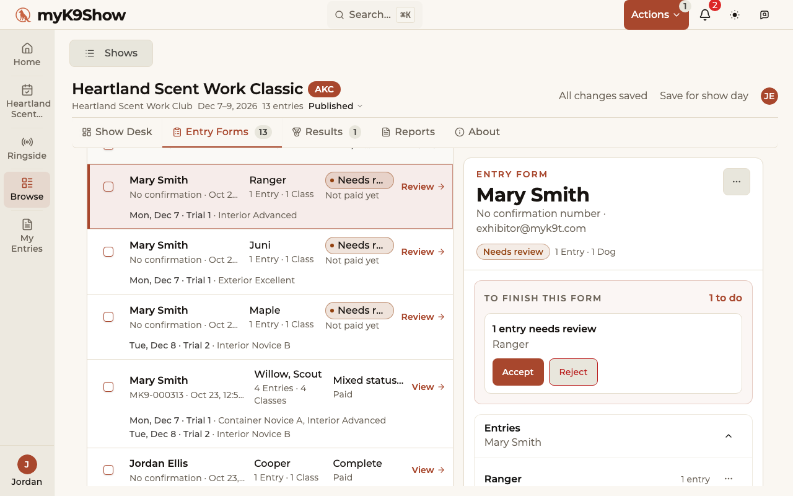

The toolbar is **Search** and **Filter**. Search finds an exhibitor, dog, handler, armband, confirmation number or class. **Filter** has three fields, each with a count: **Status** (**Needs review**, **Missing info**, **Payment due**), **Trial** and **Class**. Pick nothing and you see every form. The sentence under the toolbar says how many entries and forms you are looking at.

The header **Actions** button holds the rest. On **Entry Forms** it lists:

- **Entry lists**: **Pulls**, **Move-ups**, **Registration number needed**, **Waitlist** and **Check-in desk**. Each opens as its own list, with **Back to entry forms** to return. A count shows beside a list with something waiting, and the same count lights the Actions button.
- **Add late entry**, under the **Show day** heading (card 6).
- **Export CSV**, the whole entry list, under the **Entry forms** heading.
- The show's own items at the top: **Edit show**, **Add entry**, **Add Trial**, **Add classes**, **Select classes** and **Close out show**.

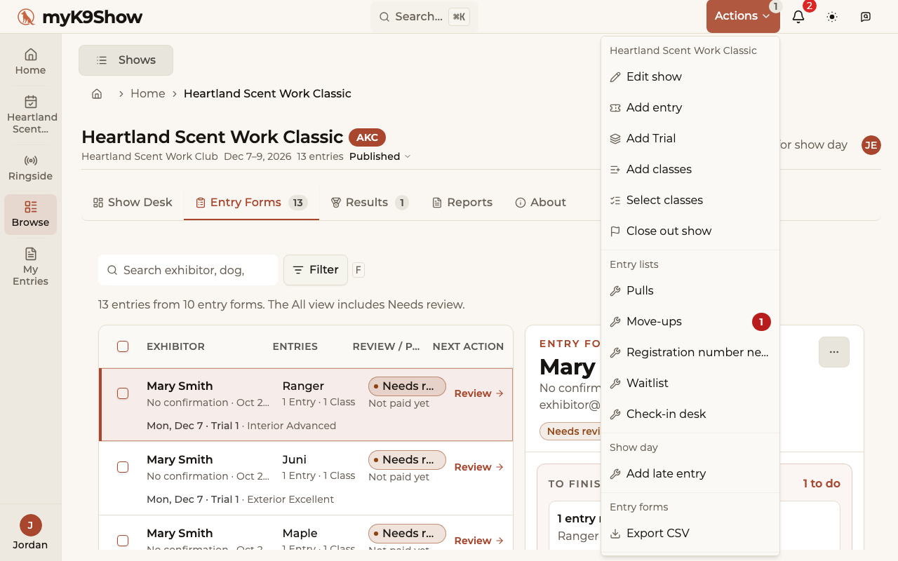

Click a form to open it. At the top is the exhibitor's name and a **⋯** menu beside it. Add entry for, Email exhibitor… and Add private note… appear only on mail-in (paper) forms. A form from an online checkout lacks them; use the header **Actions → Add entry** instead, and the **$ due** card below has no Cash… or Check… buttons either (online payments follow Stripe).

- **Add entry for** the exhibitor opens the entry flow already on them (card 5).
- **Email exhibitor…** opens the message composer addressed to that one exhibitor, so you can write to them about this form.
- **Add private note…** keeps a note on the form. Only show officials can see it. The exhibitor never does.
- Under **All entries on this form**: **Accept all** and **Reject all**. They apply to every entry on the form. An item reads "2 of 3" when only some entries can change (already scored, say), and is greyed out when none can.

Under it, **To finish this form** lists only what is left, one card each, with the button that does it:

- **N entries need review**: **Accept** or **Reject**.
- **N entries are missing information**: use **Edit entry** on the entry's menu.
- **$ due** (mail-in forms): **Cash…**, **Check…**, or the more options (**Partial Payment…**, **Paid in Full: Online**).
- **A dog has no armband**: **Assign**.
- **A dog needs a registration number**: **Add number**.
- **On a show day, N runs to check in**: **Check in all** (card 18).

When nothing is left it collapses to a green **All set.** line saying what was done.

## 5 · Add a mail-in entry

**Actions → Add entry** (the top-bar Actions button, on any page of the show). Or open the exhibitor's form on **Entry Forms** and choose **Add entry for** them from its **⋯** menu. Pick the dog and handler (or create them), choose classes, and record payment. The same flow enters your own dog: search for it like any other.

> This works **after entries close** — you're the trial secretary, so the deadline doesn't block you.

**Adding a dog that isn't in myK9Show yet.** Add Dog starts with the registration number, so you don't add the same dog twice:

1. Choose the registry (AKC, UKC or ASCA) and type the dog's registration number.
2. Choose **Find dog**.
3. If the dog is already in myK9Show, you see its name. Choose **Use existing dog** and carry on with that dog.
4. If it isn't, the rest of the registration opens. Fill it in, choose **Save and continue**, then add the dog's name, sex, date of birth and owner.
5. If the number is missing or hard to read on the paper entry, choose **No registration number yet**. You add the dog's details without a number, and the entry is held (see below).

> **No registration number yet?** You can still enter the dog. As the trial secretary,
> the entry saves and takes its place in the class, so a mail-in with a missing or
> illegible number does not lose its spot. Until the dog has a number for the trial's
> registry the entry is _held_: it still counts toward the class limit, but it is left
> off the catalog, the run sheet, the scoresheets and the emergency packet.
>
> Held entries are listed in **Entry Forms → Actions → Entry lists → Registration number
> needed**, with a count. When the number arrives, choose **Add registration** on its row. The entry
> leaves the list and appears on paperwork from then on. If the exhibitor will not
> supply a number, choose **Pull / Withdraw** to open the entry and decide. Nothing is
> pulled or withdrawn for you, even on show day.
>
> At the ring, a held dog keeps its place in the run order but shows **Registration
> number needed, see the secretary**, and it cannot be scored until the number is added.
>
> Exhibitors entering their own dogs still need the number first.
>
> **One exception:** conformation puppy classes. AKC allows a puppy to be entered while
> its registration is still processing, and those entries are never held.

> The payment reference you enter shows on the exhibitor's form in **Entry Forms**,
> so you can look a cheque number up later.

## 6 · Take a late or walk-in entry on show day

**Entry Forms → Actions → Add late entry.** Same flow as entering for someone else. The row is greyed, with the reason, when no class has room.

## 7 · Manage the waitlist

**Entry Forms → Actions → Entry lists → Waitlist.**

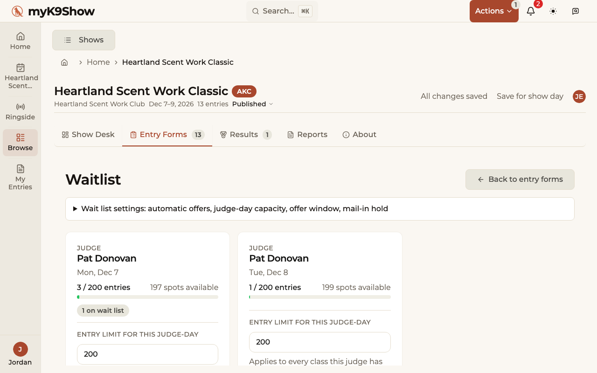

**Turn it on first.** A full class only queues people when wait lists are on for it. One switch covers the whole show: **Allow wait lists**, under **Wait list settings** at the top of this tab. It starts off, so a full class turns new entries away until you switch it on, and it saves the moment you flip it. Every class follows it.

To treat one class differently, click the class on the show home, then **Edit class**, and in **Entry limit and wait list** flip **Allow wait list** for that class (and set an **Entry limit**, or leave it blank for no class limit). The line under the switch says which applies: **Follows show: On** (or Off), or **Set for this class only**. **Use the show setting** hands the class back to the show switch. A class you set on its own keeps its setting when you change the show switch.

Whether open spots are offered automatically, the judge's daily capacity, how long an offer lasts, and the mail-in hold are under **Wait list settings** too.

1. Each judge-day shows as a card — the judge's name, the date, and how full it is (for example _3 / 200 entries_). A day at or over its limit reads **Full** with 0 spots available. It can read over the limit (for example _3 / 2_) when the limit was lowered after entries came in, or when a late entry was added with the capacity override.
2. **View Wait List** on a card lists every dog waiting in that judge-day's classes, one block per class in the order people joined, with the day's own numbers (limit, entered, available) above it. **Show every class** goes back to the whole show, which is what the tab lists until you pick a day.
3. When a spot opens, who offers it depends on **Offer open spots automatically** under **Wait list settings**. It is on for every show until you turn it off, and it saves the moment you flip it.
   - **On:** within 15 minutes the system offers the spot to the dog at the top of the queue (the order people joined), and you get a notification in the bell naming the dog and the class, with a **View** link back to this tab. It makes one offer per class at a time, and the system never adds a second offer to a class that already has one. You can still offer a spot yourself.
   - **A mail-in dog at the top is never offered automatically.** You get one bell notification, **Mail-in dog needs an offer**, naming the class and the dog, and the class waits for you: the dogs behind it are not offered in its place. Offer it yourself with **Offer Spot**. The notice is sent once, not again at every check.
   - **Off:** nothing is offered for you. Click **Offer Spot** on the dog at the top of the queue (the button only appears while the class has a free spot).

   Either way the dog moves off the queue and the exhibitor gets an email, a push notification and an in-app message; your own offer's message carries a payment link, and an automatic one sends them to My Entries to pay. The spot is held for the offer window (48 hours unless you change it under **Wait list settings**) and counts as taken until it is paid or lapses. Once a trial's date has passed, nobody can offer its spots, you or the system.

4. **Offered (N)**, above the queue, lists every open offer: the dog, the class, when it was offered, **Pay by** with the deadline (or **No automatic deadline** for a mail-in dog), and where payment stands. **Withdraw offer** takes an offer back: the payment link stops working, the entry waiting for payment is cancelled, the dog leaves the wait list, and the exhibitor is told no payment is due.
5. **Remove** takes a waiting dog off the queue for good. The exhibitor is not told.

**What the exhibitor sees.** On My Shows, under **My Wait List Positions**, each dog shows its place in line. An offer reads **Spot offered** with **Claim by** and the deadline in the trial's time zone, and two buttons: **Complete payment** and **Decline**. A mail-in offer instead says the club is holding the spot until they pay the club directly. Declining ends the offer at once, and the spot goes to the next dog the same way a lapsed offer does.

> **Capacity is enforced by the server, not just displayed.** Since 2026-07-12 an online entry that would put a class or a judge's day over its limit is refused or, where the class takes a wait list, queued. The numbers on the cards are a view of that limit. Only a late entry added with the capacity override, or lowering the limit after entries exist, can take a day past it. A class can also read **Full** for up to 30 minutes while an exhibitor pays for its last spots: those spots are held at checkout and open again if the payment is not finished.

> **When an offer lapses.** If an offer is not paid in time it lapses and no money is taken. With automatic offers on, the next dog in line is offered at the same 15-minute check and you are notified; with them off, the spot waits for you to offer it.

> **Needs a connection.** Offer Spot, Withdraw offer and Remove need a signal; at the show with none, they read **Online only**.

## 8 · Handle pulls, withdrawals and refunds

Three jobs look alike. Pick by the reason, because each one treats the money differently:

| Choose           | When                                                                           |
| ---------------- | ------------------------------------------------------------------------------ |
| **Pull**         | The dog is not competing, for any reason. No refund promise: the club decides. |
| **Withdraw…**    | Only for In Season or Judge Change. Refund per the premium.                    |
| **Remove entry** | The entry was made by mistake. It removes that entry.                          |

Pull and Withdraw are never the same thing, and neither one refunds anyone by itself.

- **One entry.** On the exhibitor's form, click the status beside the class (Pending, Accepted and so on). The menu has **Pull** and **Withdraw…**, each with its one-line help. **Remove entry** is in the **⋯** menu beside the dog on that entry's row, next to **Edit entry**, **Check in** and **Change class…**. It asks you to confirm. There is no Delete entry in the edit panel any more.
- **All of one dog's entries.** Beside the dog's name on the form, the **⋯** menu offers "Pull Maple from all entries" and "Withdraw Maple…" (with the dog's own name). Each asks once, then does every entry of that dog on this form that can still change. The same exhibitor's other forms stay as they are. Entries that have already run or been moved are left as they are, and the box lists them. The Withdraw box shows the refund the premium suggests for each entry, and issues none.

**Entry Forms → Actions → Entry lists → Pulls** (the page heading reads _Pull Management_).

Pending and pulled entries sit together. Each pulled entry shows one of:

- **Issue refund** — opens _Refund entry payment_; its **Issue refund** button refunds the exhibitor's card through Stripe straight away ("Refunded $X to the exhibitor's card").
- **Deny refund** — records that you did not refund, per your published policy. No money moves.
- **Refund issued** — a label, not a button: this entry has already been refunded.
- **No online payment** — nothing to refund through Stripe (paid by cash or check, for example). Refund those by hand.

> Record a decision on every pulled entry as you go. Closeout counts pulls with no decision as a concern.

> Refunds the system queues on its own (an overfilled cart, a payment link, an abandoned cart) are different: since October 2026 they wait for a site administrator to approve them. A secretary's **Issue refund** is not queued — it refunds immediately.

## 9 · Email your exhibitors

**Message Center**: the bell icon in the header.

1. Open **Message Center** and choose **Compose**. The message box always opens empty, so a stray tap on Send never sends canned text.
2. Choose who it goes to: **Everyone in show**, **A class**, or **Everyone checked in**. When you open it from a show's pages, that show is already picked.
3. Optionally tap a ready-made message to start from (**Lunch ready**, **Ring paused**, **Results posted**, **Report to gate**, **Class delayed**), then edit the **Title** and **Message**.
4. **Send push alert** is on for time-sensitive news. Turn it off to send quietly.
5. Switch on **Also send by email** to reach exhibitors who do not have the app open or push turned on. Before you send, a line says how many people will get the email and names anyone with no email address on file.
6. Choose **Send message**.

If the message goes out in the app but the email does not, the box says so, nothing is sent twice, and your text stays so you can look at **Email delivery history** (also on **About**) before trying again.

The **Show messages** tab of Message Center lists the show's announcements and messages. Once it has some, a **Search messages** box and a sort (**Newest first**, **Oldest first**, **Priority**, **Unread first**) sit above it, and **Unread only** narrows it to what you have not read.

> **Registration number needed email.** An entry saved for a dog with no registration number is held. To tell the exhibitor, open **Entry Forms → Actions → Entry lists → Registration number needed** and choose **Email exhibitor** on the row. The email names the dog, the show and the registry, says the entry is held, and explains how to add the number: on the dog in myK9Show, or by sending it to you. Read it, then **Send** or **Skip**; nothing goes out until you send it, and it goes in one step. If the send fails, myK9Show says so at once; press **Send reminder** on the row to try again. Once an email has been sent the button reads **Send reminder**. If the exhibitor has no email on file the row reads "No email on file. Contact by phone." and has no button. Once the number is added, no further emails go out, and a send started just after is stopped. This email is not part of the **Scheduled emails** batches: your club can turn it on or off there, but it is always sent from the list, one entry at a time.

## 10 · Payments

Payment status shows on every exhibitor's form in **Entry Forms**; **Filter → Status → Payment due** lists the ones still owing. A mail-in form with money owed has a **$ due** card under **To finish this form** with **Cash…** and **Check…** buttons to record what you were handed. An online-checkout form has no such buttons; its status follows Stripe.

> **The label tells you how it was paid, when the app knows.** An entry recorded as a cheque reads **Paid by check**, cash reads **Paid by cash**, and one you marked paid yourself reads **Paid — recorded by secretary**.
>
> **An entry that just says "Paid" means the channel was never recorded** — not that it came through Stripe. Older entries taken before the app captured a method read this way, so don't count a plain "Paid" as an online payment when you reconcile against your payout.

---

# Getting ready for show day

## Check the show is ready

In the week before the show (from seven days out to the day before), **Show Desk** carries a **Ready for show day** list. Each line is green when done and links to the fix when it is not: show details, trials and classes complete, judges assigned to every class, premium published and current, show visible to exhibitors, entries reviewed, check-in sheets and score sheets printed (only once you have started tracking paperwork, see card 14), and this device ready to work offline. When every line passes it shrinks to "Everything is handled."

**Save an offline copy on the device you will use.** **Save for show day**, at the top of the show page beside "All changes saved", puts the show and your permissions on that device so it keeps working with no signal. From three days before the show until its last day ends, a device with no copy shows an amber "Offline copy: not saved on this device" with the **Save for show day** button. Earlier than that the amber stays away and the button is quiet, so save it on the show-day device in the days before. Once saved, the line reads "Offline copy: saved on this device".

## 11 · Set the run order

**Show Desk → click the class → Run order.**

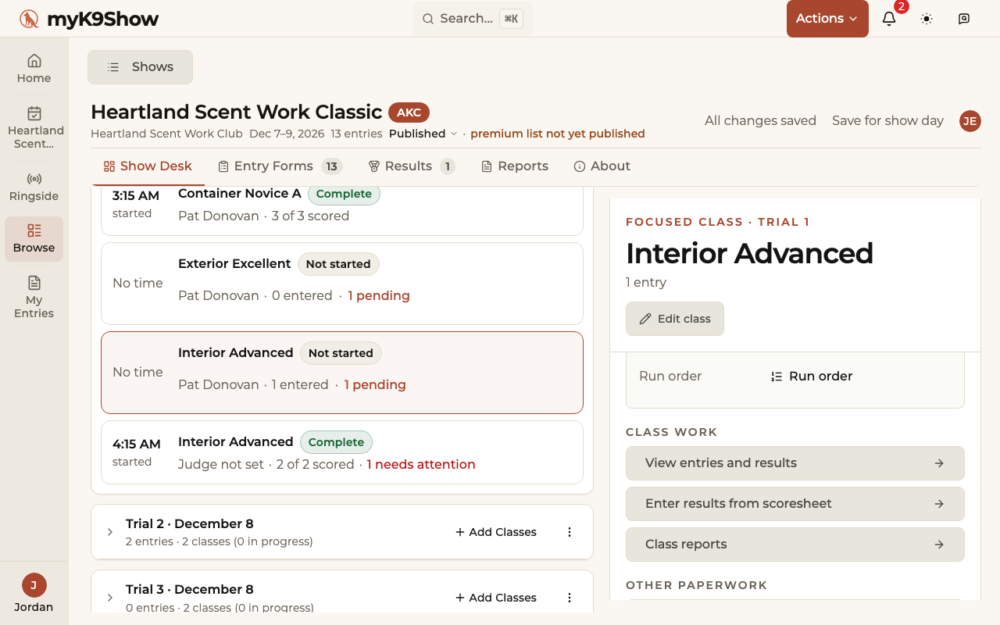

Choose **Armband ↑**, **Armband ↓**, or **Random**. The order applies immediately and appears on check-in sheets and at ringside. The menu appears once a class has two or more entries.

> You can also reach this from a class's page — **Set run order** takes you straight to that class on **Show Desk**.

To put one dog in a specific spot, open **Run order → Reorder manually...**. Each dog has **Move up**, **Move down** and **Move to…** controls. A dog that has run, or is in the ring, keeps its place and shows why; other dogs move around it. **Undo** appears for a few seconds after any run-order change.

> Armband ↑, Armband ↓ and Random sort every dog that has not run again, so they replace anything you placed by hand. Place dogs last.

## 12 · Print check-in sheets

**Reports → Check-in Sheet.** Scope it to a trial or a single class, then print. Columns are Gate Order, Armband, Call Name, Breed, and Handler. **Order** is the dog's position on the sheet (1, 2, 3 and so on), counted for each class.

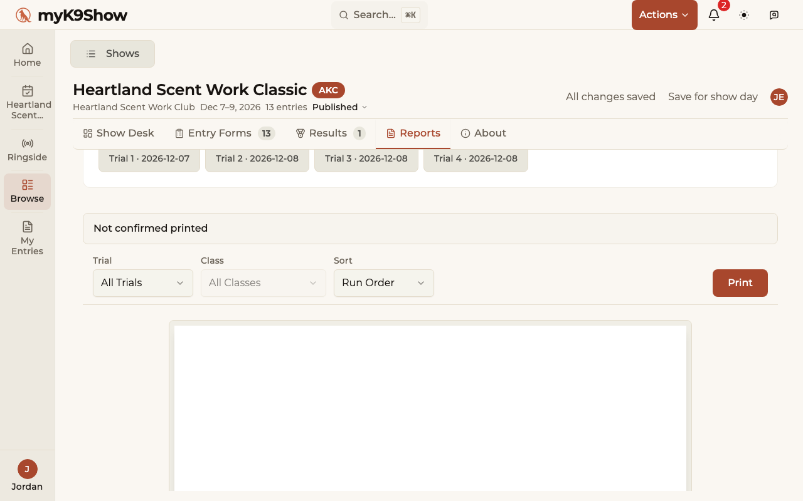

## 13 · Print scoresheets

**Reports → Score Sheet.** One page per dog, with the registry's own fault and scoring layout.

> Your registry may have its own named version — **UKC Nosework Trial Score Sheet**, **ASCA Scent Detection Score Sheet**. Pick the one matching the trial's registry.

**Judge setup cheat sheet.** For AKC and UKC shows, **Reports → UKC Judge Setup Cheat Sheet** (or **AKC Judge Setup Cheat Sheet**) prints the registry's search-area setup values to hand the judge: one table per element and level, with short quotes from the rulebook underneath. The UKC sheet includes a page for Handler Discrimination. It is static, so it prints even before anyone has entered.

## 14 · Track each class's paperwork

**Show Desk → click the class → Class checklist.** Seven items: Check-in sheet, Score sheets, Class started, Scoring complete, Preliminary results, Result labels, and Judge's initials collected (Judge signature collected for UKC and ASCA). The squares on the class's schedule card mirror it.

> **It stays out of the way until you use it.** A show that has never printed a sheet from the app, recorded a sheet as printed, or recorded a judge's sign-off shows no squares or counts on the schedule, no "Not confirmed printed", and no "Prepare" chips. The class's **Class checklist** sits collapsed in its panel: open it and it is all there. Print one sheet or record one sign-off and the whole checklist appears, for the show.

- Print items have **Print** (or **Reprint**). It opens a preview in a panel beside **Show Desk**, so you never leave the page. When the print window closes, the sheet is recorded as printed and the row reads **Printed 2:14 PM · Undo**. Cancelling the print window records it too, so tap **Undo** if nothing came out.
- To print the check-in and score sheets together, tick the box beside each one and tap **Print selected**.
- An item that changed after printing reads **Needs reprint** (an amber square), for example score sheets after a class change.
- Preliminary results, Result labels and the judge's sign-off are status only on **Show Desk**. Once the class is complete, tap **Continue on Results** under the checklist to check and release the scores, print those two sheets and record the judge's initials (card 23).
- Items can be done in any order; nothing blocks anything else.

## 15 · Ringside access codes

**Show Desk → Actions → Access codes.** Separate codes for Admin, Judge, Steward, and Exhibitor. Copy a code, copy a share link, print a slip, or generate new codes if one gets out.

## 16 · Volunteers, lunch orders, and the paper fallback

All under **Show Desk → Actions**:

- **Volunteers**: add volunteers and assign them to per-class slots grouped by trial.
- **Lunch orders**: one list for each show day, for anyone working it. That day's judges, officials and volunteers are on the list already. **Add person** opens a name and role, and **Add to list** adds them. Give each person a lunch order and a dietary note, then press **Save** on that row. Closing the panel with unsaved rows asks first.
- **Judge supplies**: every judge at the show, once, with the trials they judge. Open a judge to set what they are handed. The list applies to every trial that judge is on, so a judge on two trials is set up once. **Reports → Judge Supply Checklists** prints them.
- **Hospitality plan**: **Reports → Hospitality plan** prints the headcount by role for each show day, with the lunch orders and dietary notes. Print it before the show, once volunteers and lunch orders are in, and hand it to whoever runs hospitality.
- **Tasks and notes**: reminders for this show.
- **Emergency trial packet**: prepare or confirm the printed paper fallback, in case devices or signal fail on the day.

Volunteers and the Emergency trial packet only show here while their **This show uses…** switch is on (card 3). Both start off on a new show.

---

# Show day

## 17 · Run a class: status, start time, delays

**Show Desk → click the class.** In its panel, under **Class settings**:

- **Status** — Not started, In progress, Complete, or Cancelled. Marking a class complete with scores still unentered asks you to confirm.
- **Expected start → Set expected start** — a revised start time when a class runs late or early.
- **Announce the delay** — appears before a class starts when it is running late; it opens the delay message already filled in with the class and the minutes.

## 18 · Check dogs in

The **Check-in desk** is the one list of exhibitors, with armband, class, time and check-in state for every dog:

- Open it from **Show Desk → Actions → Check-in desk**, or **Entry Forms → Actions → Entry lists → Check-in desk**. On **Show Desk**, the "Check in N entries" chip in the **Needs attention** strip opens it already filtered to **Not checked in**.
- The search box is ready when it opens. Type a name, a dog or an armband. **All exhibitors** and **Not checked in** switch the list.
- **Check in** on a dog's row checks in that run. **Check in all eligible** on an exhibitor checks in everything of theirs that is ready.
- Check in is offered only on the trial's own day, for an accepted entry that is not in yet. Other rows say why (for example **Not today**). A dog already at the gate or in the ring shows its ringside status, such as **At Gate** or **In Ring**, and has no **Check in** button.

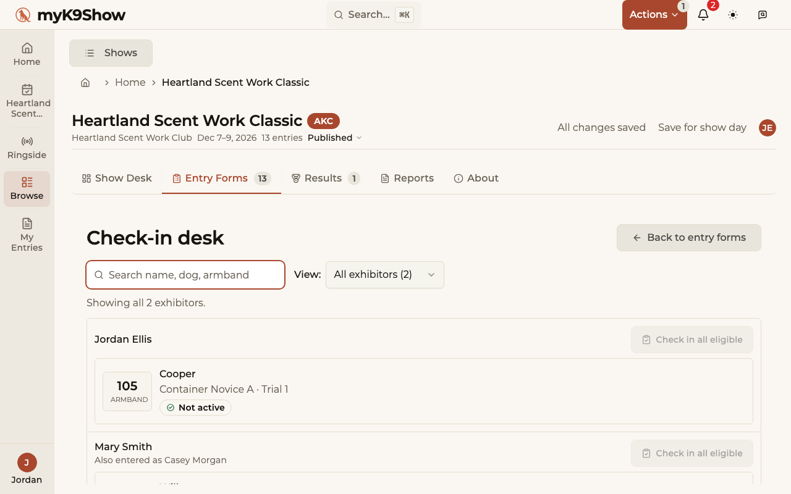

On a show day you can also check in from an exhibitor's form on **Entry Forms**. **To finish this form** gets a "N runs to check in" card with **Check in all**, and each entry's **⋯** menu has **Check in**.

For one class, **Show Desk → click the class → View entries and results** opens the class's run sheet, with a check-in status on every dog's row.

**Show Desk → Actions → Self check-in** lets exhibitors check themselves in, by show, trial or class.

## 19 · Change a dog's class

There are two doors to the same action, and either one works until the dog has run:

- **Show Desk → click the class**, then open the **⋯** menu at the end of that dog's row in the entries table and choose **Change class**.
- On **Entry Forms**, open the exhibitor's form and use **Change class…** in the **⋯** menu on that dog's entry.

Choose the target class and give a reason. Targets are restricted to the same element at a strictly higher level, so you can't move a dog somewhere ineligible. On the class panel, a dog that cannot move now (a pending entry, for one) has no **⋯** menu: accept it first. On **Entry Forms**, **Change class…** is always in the menu but greyed with the reason ("Accept this entry first.", already run, in the ring, or its class has started). Either door needs a connection.

> The original entry stays on the books as _moved_ and keeps its fee; the new entry is created at no extra charge.

> An exhibitor can also _request_ a move-up before the show. Those arrive in **Entry Forms → Actions → Entry lists → Move-ups** for you to approve, deny, or waitlist.

## 20 · Enter results from paper scoresheets

**Show Desk → click the class → Enter results from scoresheet.**

Per dog, record the result (Q, NQ, ABS, EX), the search time, and any faults. Search time is digit-masked — type `4520` for 45.20 seconds.

> Placements are calculated for you once every dog in the class is scored. You don't enter them.

## 21 · Log an incident

**Show Desk → Actions → Incident log.** Record what happened while the details are fresh. Closeout reads the log and lists reportable incidents as a concern.

## 22 · Print the results sheet

**Results → the class**: once the class's results are released, its **Primary work** card asks you to print the results sheet and result labels, then record them as printed (card 23). To print one on its own, use **Reports → Results Sheet**. Element, level, trial, date, and judge, with each dog's result and placement.

---

# After the show

## 23 · Release results to exhibitors

**Results.** Each class is a row with a status and the next thing it needs. A class still being scored sends you back to **Show Desk**. Once every dog is scored and the class is marked complete, open it and work down its **Primary work** card:

1. **Record coin flip** if dogs finished tied for a ribbon. Flip, say who won, then check the scores.
2. **Check scores** (the card reads **Release the results**): look the scores over, fix anything that is off, then choose **Release results**. That saves your check and makes the scores visible to exhibitors. If scores change after a release, the card reads **Confirm the scores** and the button **Confirm scores**.
3. **Print the results sheet and result labels**, and record them as printed.
4. **Record the judge's initials** (a signature for UKC and ASCA) once the judge's day is over: print the marked catalog, have the judge initial it, and record it under **Judge sign-off**.
5. The class then reads **Done**.

**More → Visibility settings** decides when exhibitors can see a score at all.

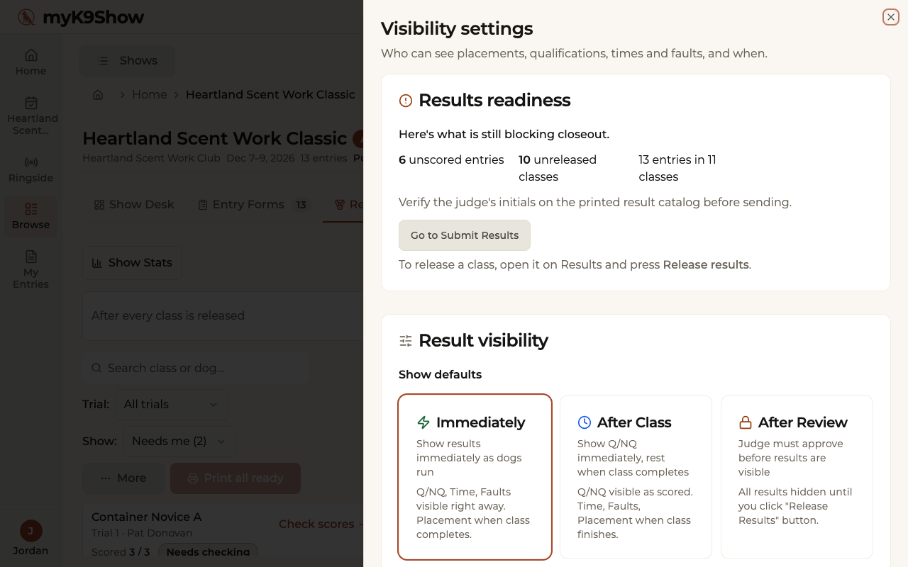

Set the show default (**Immediately**, **After Class** or **After Review**), then override a trial or a class that needs it. A trial or class with no override follows the show default.

> If results are not appearing for exhibitors, look here first. A class set to _After Review_ stays hidden until you release it.

> Closeout expects every class released, so finish this before card 26.

## 24 · Submit results to the registry

**Results → Submit to AKC (or UKC, or ASCA).** The button sits in the Finish the show row at the top of the Results tab, next to **Close the show**. What you see here depends on the registry.

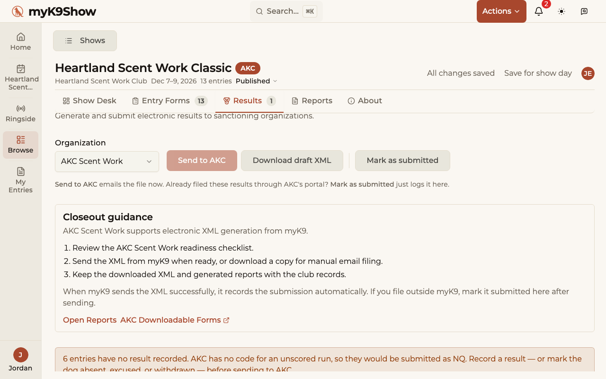

**If the registry accepts electronic submission (AKC):**

1. Check **Closeout guidance** for anything outstanding — most often entries missing a registration number.
2. **Send to AKC** emails the results file for you. This is the normal path.
3. If you already filed through AKC's portal, use **Mark as submitted** instead — that only records it here.

**Download XML** gives you the file itself if you want a copy or need to file it another way.

> **If Send to AKC is greyed out**, the preflight found blocking problems — usually missing registration numbers. It stays disabled until they're fixed, and the download is labelled **Download draft XML** while that's true, so you can see the draft without being able to file it.

**If the registry files manually (UKC, ASCA):** there is no Send action and no XML download. Submit through the registry's own process, then use **Mark as submitted** to log it here. **AKC Downloadable Forms** links registry paperwork where it applies.

> **Mark as submitted records _your_ action** — it does not confirm the registry received anything. Keep their acknowledgement as your proof.

## 25 · Registry reports

**Reports**, filtered to your registry. The main ones:

| Registry | Reports                                                                                                                                                                |
| -------- | ---------------------------------------------------------------------------------------------------------------------------------------------------------------------- |
| All      | Steward's Report · Financial Report                                                                                                                                    |
| AKC      | AKC Trial Secretary Report · AKC Trial Secretary Certification · AKC Trial Chairman Report · AKC Judge's Report · AKC Judge's Certification Report · AKC High in Trial |
| ASCA     | ASCA Scent Detection Trial Report · Trial Roster · Gross Receipts Report · Post-Event Evaluation                                                                       |
| UKC      | UKC Nosework Trial Report · UKC Nosework Judges Book: Element Trial · UKC Nosework Judges Book: Handler Discrimination                                                 |

Each renders the registry's own instructions and layout.

## 26 · Close out the show

**Results → Close the show.**

1. Read the reconciliation — entries, day-of entries, collected at the show, waived, and pulled or no-show — and check the totals match what you took.
2. Choose **Close out show** and confirm.

> If the readiness check has concerns, the confirm button reads **Close anyway**. That's your decision to make, but read what it's flagging first — it's usually results not released, pulls with no refund decision recorded, or reportable incidents.

> **The show stays open until you do this.** Reading the summary is not closing the show.

## 27 · High in Trial

**Reports → AKC High in Trial**, then narrow it to a trial. AKC trials only.

The report works out who is eligible and ranks them for you. One section per difficulty level, showing the elements counted, each team's faults and time per element, and the totals they were ranked on.

> **A level only gets a High in Trial if the trial ran more than one element at it** (Container, Interior, Exterior, Buried). A level running a single element is listed as excluded rather than left out silently.

> **Eligibility is all-or-nothing.** A team must have entered _every_ element offered at its level and qualified in each. Handler Discrimination never counts, even when you offer it.

> **A tie is shown as a tie.** If two teams match on both faults and time, the report says so and tells you a coin flip decides it. It will not pick a winner for you — record the outcome by hand.

> **Wait for PROVISIONAL to clear.** While any entry at that level has no result, the level is labelled provisional and the standing can still change. Don't hand out the trophy until it's gone.

> Per-class placements (1–4) are calculated separately and automatically — see card 20.

> **High Combined Division appears in the same report** when a trial offers High in Trial and Handler Discrimination. Each HCD level counts its available odor classes plus Handler Discrimination, even when fewer odor elements run at that level. A team must qualify in every available odor element plus Handler Discrimination at that same level. Totals include all of those runs, ranked by fewest faults then fastest time; exact ties need a coin flip recorded by hand. PROVISIONAL means results or ranking numbers are still missing. If no team qualifies in every required class, there is no HCD award (AKC Chapter 6 §§9–10).

---

## Known gaps and rough edges

Honest list, so nothing surprises you mid-show.

| What            | Status                                                                                                     |
| --------------- | ---------------------------------------------------------------------------------------------------------- |
| Waitlist offers | Paying for an offer through Stripe is not yet covered by the automated waitlist journey (card 7, MYK9-971) |

---

## Still need help?

Full findings behind this guide, including anything fixed recently: `docs/audits/2026-08-28-secretary-task-walk.md`.
